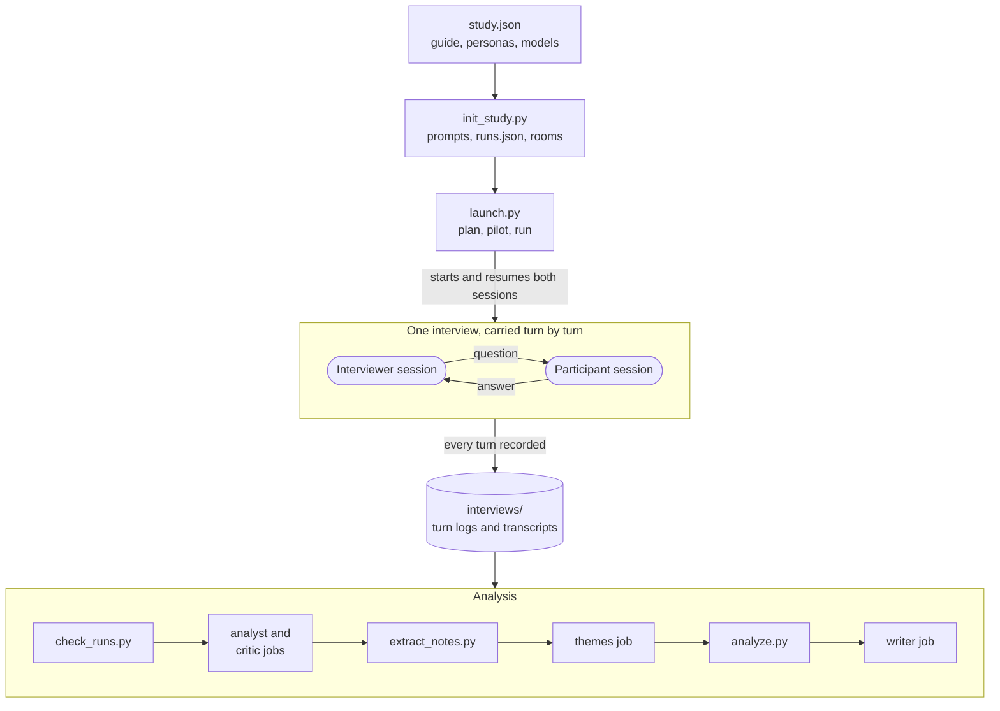

# Persona panel: interview studies

**Status:** Ready, 13 October 2026. Discovery (milestone 1) was done that
day and is recorded under [Discovery](#discovery). Milestones 2 to 4 are not
built or tested. What will be built differs from the text below in places:
each is in
[Deviations decided during discovery](#deviations-decided-during-discovery),
which wins where the two disagree, and the body points to it at each such
place. The user settled the open questions on 13 October 2026, and two more
after discovery: [The user's decisions](#the-users-decisions). Codex reviewed
the PRD over three rounds that day, before discovery, and approved it with
the first twelve decisions in.

PRD for a third study type in the `persona-panel` skill
(`packages/common/agents/.agents/skills/persona-panel/`): simulated discovery
interviews, run the way [The Mom Test](https://www.momtestbook.com/) teaches.

1. **An interviewer agent** talks to each persona in turn: it asks, reads the
   answer and drills down, within a discussion guide the user approved.
2. **The launcher carries every turn** between the two sessions and writes the
   transcript, so neither side needs to write a file.
3. **The analysis codes each transcript** into problems, tallies them across
   participants and segments, and critiques the interviewer's questions.
4. **A later addition** reuses the same turn loop: a debrief interview in
   the session of a finished review or usability run.

It follows [persona-panel-expansion.md](persona-panel-expansion.md), which
built the runners, the launcher, follow-up questions and usability studies.
That PRD lists moderated interviews as a non-goal. This one reverses that.

## Checked against the code

The design discussion read only `SKILL.md`, `scripts/followup.py` and
`scripts/init_study.py`. Its claims were checked on 13 October 2026 against
the working tree of `persona-panel-expansion` at `21ff323`, which had
uncommitted changes from other work in progress. Recheck anything below that
names a function before building.

Confirmed:

- The `description` in `SKILL.md` is 1,022 of 1,024 characters.
- `followup.py` resumes a finished run's own session with one question, as
  one more attempt on the run (kind `followup`), under the study lock, a
  watchdog and `limits.followup`.
- Usability was added as a type with its own reference file, assets and a
  branch in the scaffold (`scaffold_usability`).
- `synthesis.analyst` and `synthesis.writer` are model entries with no
  default, and the study brief is refused under `panel/` and in
  `synthesis.context_files`.

Corrected:

- **The follow-up is not the turn primitive as it stands.** It asks only a
  `done` run, and settles each answer by comparing the persona file with a
  copy made before the question. An interview reuses what sits under it: the
  supervisor in `launch.py`, the lock, the watchdog, the runners' resume
  commands and the usage record.
- **"A participant needs no file access" is not available today.** Both
  runners pass file tools on every launch (`FILE_TOOLS` in
  `runners/claude.py`, `-s workspace-write` in `runners/codex.py`), and the
  Codex sandbox leaves the whole disk readable. `claude --help` lists
  `--tools ""` to disable every tool, which no run has tried. Codex has no
  switch for its shell tool. So this PRD isolates by folder first and treats
  a session without tools as a [discovery](#discovery) result.
  *Changed after discovery: `--tools ""` runs and resumes, and Codex does
  have switches that remove its shell (item 4). Both sides of an interview
  now run with no tools on both runners:
  [deviations 8 and 9](#deviations-decided-during-discovery).*
- **Every resume is a new CLI process.** It repeats every launch flag, pays
  the CLI's start-up time, and on Claude Code gets a budget cap that counts
  that process alone. An interview of 30 exchanges is about 60 processes.
- **Two study types are assumed in places.** `STUDY_TYPES` has two entries
  and `check_type_keys` reads "not usability" as "review".
- **A job is one output file, and the synthesis pool is split `analysts + 1`
  ways** (`synthesis_share`). The new job roles change that arithmetic.
- **Analysts and the writer work in the study directory**
  (`panel_lib.workdir`). Keeping a file from them is an instruction, as it is
  for `study-brief.md` today.
- **Native mode cannot run an interview.** The turn loop is the launcher's.

## Problem

The skill answers "which concept do prospects prefer" and "can they complete
this task". It cannot answer the question that comes before both: what
problems do these people have, and which of them matter.

The example behind this PRD: what mortgage brokers struggle with day to day,
what their main challenges are, and what challenges they have with the
user's own tool.

A follow-up question is the nearest thing today. It puts one fixed question
to a panellist who has already reviewed something. It cannot open a topic,
react to an answer or dig past the first shallow one.

The user also wants to learn the technique: to read the questions, the answers
and how the interviewer drilled down, and to rehearse a guide before real
interviews.

## Goals

- The lead helps the user draft the learning goals and a discussion guide,
  and the user approves the guide and the roster before anything runs.
- Each participant is a persona on a chosen model entry, as today. The
  interviewer's model is set once for the study.
- The interviewer follows The Mom Test: past behaviour and specifics, no
  pitch, no hypotheticals, compliments deflected, each problem followed to
  its consequence, its workaround and what was tried.
- Every interview leaves a transcript that shows each question, the move the
  interviewer meant to make and why, and the answer.
- An interview survives a kill, a usage limit and a rate limit, and resumes
  at the turn it reached.
- The analysis reports problems by how they were raised and how well they are
  evidenced, with no scores.
- A critique marks leading, hypothetical and pitching questions, missed
  signals and good moves, so the user can learn from it.
- Existing studies and archives keep loading, and the review and usability
  workflows do not change.

## Non-goals

- **Evidence about real customers.** A persona answers from a model's
  training data. The output is hypotheses and a rehearsed guide.
- **Commitment and advancement.** The book's test of a solution is what
  someone gives up for it. A simulated yes to a pilot proves nothing, so the
  interviewer never asks for one.
- **Recruiting.** Finding conversations, invitations and warm introductions
  have no place in a simulation.
- **Interviews in native mode.**
- **Interviews on the Pi runner,** and any work on the Pi, OMP or OpenCode
  runners. An interview study refuses a Pi model entry: [Runners](#runners).
- **Practice mode and background material.** Both are
  [deferred](#deferred).
- **An interviewer that learns from one interview to the next** inside a
  round. See [Design decisions](#design-decisions).
- **Scores, leaderboards, capture, concept labels and review orders.**
- **Group interviews**, and more than one interviewer in a conversation.

## Terms

| Term | Meaning |
| --- | --- |
| Interview | One participant's conversation with the interviewer: one run |
| Participant | The panellist of an interview study: a persona on a model entry. Its `runs.json` role stays `panellist` |
| Interviewer | A headless session that asks the questions. One per interview, on the study's `interview.interviewer` model entry |
| Guide | The learning goals, topics, opening questions and turn caps in `study.json` |
| Exchange | One question and its answer. Turn caps count exchanges. A turn number in a transcript, a note or a quotation is an exchange number ([deviation 1](#deviations-decided-during-discovery)) |
| Turn log | `interviews/<run id>.jsonl`, written by the launcher: the source of truth for an interview |
| Situation card | What a participant privately decides about its own working life before the first question |
| Room | A participant's own folder, `panel/rooms/<run id>/` |
| Debrief | An interview held in the session of a finished review or usability run |

## Design decisions

The seven the design discussion asked this PRD to settle, as the user
settled them: [The user's decisions](#the-users-decisions).

**1. Same skill, a third type.** `"type": "interview"`, built as usability
was. Personas, rosters, model entries, the launcher, limits, the plan, the
usage record, the study brief, the synthesis jobs, the archive and the notice
all carry over. A derived skill would import this skill's scripts by path and
drift from them. The `description` is rewritten for three types:
[Changes to the skill's documents](#changes-to-the-skills-documents).

**2. A separate interviewer session for each interview, never the lead.** The
lead would carry one participant's answers into the next participant's
questions, and its context would fill with transcripts.

**3. Interviewers do not learn across interviews in a round.** A real
interviewer does, and the book says to update the learning goals as answers
come in. Here it would cost three things: interviews could no longer run side
by side, a difference between two models could be the interviewer's doing,
and the first participant's wording would lead the second. Learning happens
between rounds instead. The debrief ends with a revised guide, and the next
round is a new study directory, as the book's batch procedure has it.

**4. Practice mode is deferred.** The turn loop does not care who writes the
question, so it stays cheap to add: [Deferred](#deferred).

**5. Interviews about the user's own tool happen only in a debrief.** A persona
has never used the tool, so a question about its history with it gets pure
invention. A finished review or usability run has seen it, and what happened
in that session is the only real past a persona has. A standalone interview
is discovery, and its interviewer never names the tool. A debrief is product
feedback. The two are never mixed, because the book treats feedback given
after a demo as a different kind of evidence.

**6. Background material is deferred.** A participant answers from its
persona alone: [Deferred](#deferred).

**7. Hypotheses stay with the lead.** The interviewer gets learning goals
written as things to find out, never the study brief, the idea or the tool's
name. A deterministic gate checks each question before it is delivered, and
the critique marks leading questions afterwards.
[Isolation and safety](#isolation-and-safety) has the layers.

Completeness is under [When an interview is done](#when-an-interview-is-done).

## How the parts divide the work



The turn log is the source of truth for whether an interview is done, where a
persona file is for a review. A new module, `scripts/interview.py`, holds the
turn loop's rules (parsing a reply, choosing the next turn, rendering) and
the supervisor calls it, as it calls `accounts.py` for a usability run.

## `study.json` changes

All new keys are optional for the other two types, which load unchanged.

```json
{
  "type": "interview",
  "runner": "claude",
  "models": [
    {"key": "sonnet", "runner": "claude", "model": "sonnet"},
    {"key": "codex", "runner": "codex"}
  ],
  "personas": [
    {
      "id": "P01",
      "name": "Dana Whitlock",
      "role": "Mortgage broker, sole operator",
      "segment": "solo",
      "personality": "Blunt, short of time, suspicious of new software",
      "bio": ["Eleven years broking, the last four on her own.", "..."]
    },
    {
      "id": "P02",
      "name": "Marcus Oyelaran",
      "role": "Principal of a six-broker firm",
      "segment": "principal",
      "personality": "Measured, delegates the detail, watches cost",
      "bio": ["Runs the firm and signs off every subscription.", "..."]
    }
  ],
  "interview": {
    "about": "how mortgage brokers run a loan from first enquiry to settlement",
    "interviewer": {"key": "interviewer", "runner": "claude", "model": "opus"},
    "goals": [
      {"id": "G1", "learn": "What takes most of a broker's time and attention in a normal week, and what they have done about it"},
      {"id": "G2", "learn": "How documents are collected from clients, and what happens when that goes wrong"},
      {"id": "G3", "learn": "Who decides what software the business pays for, and what was last bought or dropped"}
    ],
    "topics": [
      {"id": "T1", "area": "the working week", "goals": ["G1"], "turns": 6,
       "opener": "What has taken most of your attention at work over the last couple of weeks?"},
      {"id": "T2", "area": "collecting documents from clients", "goals": ["G2"], "turns": 8,
       "opener": "Walk me through the last loan where you had to collect documents from a client."},
      {"id": "T3", "area": "tools and spending", "goals": ["G3"], "turns": 6, "segments": ["solo", "principal"],
       "opener": "What was the last piece of software the business started or stopped paying for?"}
    ],
    "turns": 30,
    "situation_card": true
  },
  "limits": {
    "run": {"minutes": 20, "budget_usd": 2.0},
    "interviewer": {"minutes": 30, "budget_usd": 3.0},
    "turn": {"minutes": 3},
    "synthesis": {"minutes": 30, "budget_usd": 10.0}
  },
  "synthesis": {
    "analysts": 2,
    "analyst": {"runner": "claude", "model": "opus"},
    "critic": {"runner": "codex"},
    "writer": {"runner": "claude", "model": "opus"}
  },
  "leak_terms": ["LoanLoop", "doc chase"]
}
```

*After discovery: the `limits` figures above are an example and are larger
than the defaults, which are in the rules below. The models are an example
too: the rule is by tier
([deviation 10](#deviations-decided-during-discovery)).*

Rules:

- **`models`** work as they do today, and mixing harnesses is the point:
  every persona is interviewed once on each entry, here on Claude Code's
  Sonnet and on Codex's default model, so an answer that only one model
  gives shows up as model taste. The study-level `runner` is the default for
  an entry that names none. *Added after discovery: both sides need a
  mid-tier model or larger, never a vendor's smallest and fastest tier, and
  the interviewer the strongest model available
  ([deviation 10](#deviations-decided-during-discovery)).*
- **`interview.about`** is the honest, neutral purpose the interviewer may
  state when a participant asks what this is for. It names an area of work,
  never an idea.
- **`interview.interviewer`** is a model entry, as `synthesis.analyst` is.
  There is no default. One interviewer for the whole study, so that what
  differs between two runs is the participant.
- **`goals[].learn`** is written as something to find out, never something to
  prove. `init_study.py` refuses a goal, an opener or `about` that holds a
  `leak_terms` entry. The book's advice is three goals for each type of
  person, one of them uncomfortable. More than five draws a warning.
  *Added after discovery: a leak term in a topic's `area` is refused too
  ([deviation 13](#deviations-decided-during-discovery)).*
- **`topics[]`** are opened in the order written. `area` is a neutral name
  the interviewer may use to raise the topic when it has not come up.
  `opener` is the first question, sent as written. `goals` lists what the
  topic serves. `turns` is its cap in exchanges, 8 when not given.
  `segments` limits a topic to personas in those segments, so that a buyer
  is asked about buying and a user is not.
- **`interview.turns`** caps the whole interview in exchanges and defaults
  to 30. It must be at least the number of topics plus two, for the opening
  and the close.
- **`situation_card`** defaults to true: [Situation card](#situation-card).
- **`limits.interviewer`** is each interviewer's allowance over a whole
  interview. `limits.run` stays the participant's. `limits.turn.minutes`
  bounds any single turn of either side and defaults to 3. *Settled by
  discovery item 1
  ([deviation 12](#deviations-decided-during-discovery)):* `limits.run`
  defaults to 15 minutes and 0.50 USD in an interview study and
  `limits.interviewer` to 15 minutes and 1.00 USD. The minutes count a
  side's own process time. The caps above stay at 30 and 8.
- **`synthesis.critic`** is the model entry of the critique jobs. When it is
  the interviewer's own model the plan warns, and the study still runs.
- **Keys of the other types are refused**, as now: `concepts`, `tasks`,
  `target`, `accounts`, `find_the_answer`, `materials`, `browse`, `capture`,
  `factors` and `fit_factors` among them. `replicates`, variants, the roster
  grid, `segments`, `context_notes`, `leak_terms` and `runners` work as they
  do today. `context_notes` go to participants, as facts about the setting.
  *Added after discovery: `product` and `product_phrase` are refused too
  ([deviation 13](#deviations-decided-during-discovery)).*
- **Run ids and model keys** keep their rules. The interviewer of run
  `P01-sonnet` is the job entry `interviewer-P01-sonnet`.

## Protocol

### The turn loop

For each interview the launcher:

1. **Starts the participant** in its room with its prompt: the participant
   brief, the persona and any `context_notes`. With
   `situation_card` on, the prompt asks for the card as its only reply.
   Otherwise it asks for the single word "Ready".
2. **Starts the interviewer** in its folder with its prompt: the interviewer
   brief, the guide, and what a recruiter would know of the participant
   (name, role, segment). The reply is the opening and the first question.
3. **Alternates.** It resumes the participant with the interviewer's words,
   records the answer, resumes the interviewer with that answer and a status
   line, records the next question, and so on.
4. **Ends** when the interviewer ends the interview or the cap is reached,
   and renders the transcript.

One process is alive for an interview at any moment. Interviews run side by
side within each runner's concurrency, which counts processes as it does now.

*Changed after discovery, each in
[Deviations decided during discovery](#deviations-decided-during-discovery):*

- *Step 1: a first reply that is not the card, or "Ready", leaves the
  interview `failed` and no interviewer starts (deviation 4).*
- *Step 2: the interviewer's brief holds the reference text, and neither
  side has a tool (deviations 8 and 9).*
- *At most as many interviews are carried at once as the interviewer's
  runner has slots (deviation 7).*

### What the interviewer replies

Every interviewer reply has this form, and the launcher parses it:

```text
TOPIC: T2
MOVE: anchor
WHY: "We always chase documents" is a general claim, so I am asking for the latest instance.
SAY:
Which loan did that last happen on?
```

- **`SAY`** is everything after its line, and is the only part the
  participant receives, word for word.
- **`TOPIC`** is a topic id, or `open` or `close`. The launcher counts
  exchanges by it.
- **`MOVE`** is one of a fixed list, so a transcript names the technique at
  each turn: `open`, `priority`, `raise`, `anchor`, `sequence`,
  `consequence`, `coping`, `alternatives`, `frequency`, `constraint`,
  `money`, `deflect`, `dig`, `clarify`, `accept`, `close`. The list follows
  the field guide's event reconstruction and recovery table:
  [The Mom Test in the briefs](#the-mom-test-in-the-briefs).
- **`WHY`** is one sentence for the user and the critic. The participant never
  sees it.
- **To end**, the first line is `END: <reason>` in place of `TOPIC` and
  `MOVE`, and `SAY` holds a closing line, which is recorded and not sent.

A reply that does not parse gets one repair message naming what is missing.
A second failure stops the interview as `partial`, with the reply kept in
`logs/`.

*Changed after discovery: a code fence around the whole reply and blank
space around it are forgiven and need no repair (deviation 3). The one
repair names every problem found, a leak term and the last-exchange rule
included, and each interviewer slot gets one send-back whatever the reasons
(deviation 2). Both are in
[Deviations decided during discovery](#deviations-decided-during-discovery).*

### What each message carries

- **To the participant:** the `SAY` text and nothing else. No frame, no turn
  count, no topic. The brief it was launched with is its only instruction.
- **To the interviewer:** the answer between two lines of dashes, as the
  follow-up frame does, then one status line:
  `Exchange 9 of 30. T2: 4 of 8. Not opened: T3.`
- **Cap notices** ride on the status line. When a topic has used its turns:
  "T2 has used its turns: move on or close." When one exchange is left:
  "This is your last question: close the interview."

The frames are assets, sent verbatim with their placeholders filled.

### When an interview is done

An interview is `done` when its turn log has an end record. There are two
ways to get one:

- **The interviewer ended it.** If topics are still unopened and exchanges
  remain, the launcher asks once: "T3 was not opened. Open it, or confirm the
  end with your reason." A confirmed end stands, since a participant who says
  a topic does not matter is a finding. The unopened topics are on record.
- **The interview cap was reached.** The launcher writes the end record once
  the last permitted exchange has its answer. That exchange is meant to be
  the close. A question offered for it with any other `TOPIC` is sent back
  once, as a repair is, with "This is the last exchange: reply with TOPIC:
  close." If the second reply is no close either, the launcher ends the
  interview there, one exchange short and with no close, and
  `check_runs.py` notes it. Topics never opened are on record. *After
  discovery: this send-back is the slot's only one, shared with a format
  problem and a leak term
  ([deviation 2](#deviations-decided-during-discovery)).*

Unopened topics never block. They appear in `check_runs.py`, in the tallies
and in the synthesis as coverage the round did not get.

### States

The states of `launch.py` keep their meaning. Both entries of an interview
read their state from the turn log, so they never disagree.

| State | For an interview | Next |
| --- | --- | --- |
| `pending` | No turn recorded | `run` |
| `running` | A turn's process is alive, or a launcher is between two turns | wait |
| `done` | The turn log has an end record | none |
| `partial` | Stopped between or during turns: `stop`, a killed launcher, a reply that failed twice, or a turn of a side that has already replied which was stopped at `limits.turn`, ended with an error or lost its watchdog | `resume` |
| `limited` | Either side has used its time or budget | `resume --extend` |
| `blocked` | Either side's harness is turning requests away | `resume` later |
| `failed` | A side's first process ended with no reply, or a participant's first reply was not the card or "Ready" | `run` |

*The `partial` and `failed` rows were changed after discovery
([deviations 4 and 5](#deviations-decided-during-discovery)). They said "a
reply that failed twice" and "a side's first process ended with no reply",
and no more. `run` and `pilot` retry a failed first process once.*

### Resume

- **Every turn is recorded before the next starts**, in this order: the turn
  is appended to the turn log, then the attempt's end is saved in
  `runs.json`. Each turn record carries its entry and attempt number, so a
  launcher that died between the two records nothing twice.
- **A launcher that takes over a study** settles what a dead one left, as it
  does now: a process that finished while no launcher was alive has its reply
  in `logs/`, and that reply becomes its turn.
- **`resume` continues at the turn the log reached**, in both original
  sessions. Nothing is asked again that has an answer on record.
- **A turn whose reply was never captured** is put again, with one line
  saying the earlier reply was lost. The session may then hold an answer the
  transcript does not. That is accepted. *After discovery: the interviewer
  gets such a line too, and the launcher puts a lost turn again only on
  `resume`, never unasked
  ([deviations 5 and 6](#deviations-decided-during-discovery)).*
- **A lost, purged or unsaved session** of either side ends resume for that
  interview. With no participant answer on record it starts afresh. With
  some, it is reported for the lead to decide, as a partial review is.
- **`init_study.py --force`** resets every interview and moves the turn logs
  and transcripts it replaces to `logs/`.

### Limits and the plan

| Limit | Covers | Enforced by |
| --- | --- | --- |
| `interview.turns` | Exchanges in the interview | The launcher, exactly: it carries every turn |
| `topics[].turns` | Exchanges in a topic | The interviewer, on the launcher's notice. Advisory |
| `limits.run` | The participant, over the whole interview | Time by the launcher, budget by the harness where it has a cap |
| `limits.interviewer` | The interviewer, over the whole interview | The same |
| `limits.turn.minutes` | One turn of either side | The watchdog of that turn's process |

The launcher cannot make an interviewer change subject, so an exchange past
a topic's cap is delivered, counted, noted by `check_runs.py` and bounded by
the interview's cap.

*After discovery: a turn stopped at `limits.turn` leaves the interview
`partial`, or `failed` at a side's first process. It is never `limited`
([deviation 5](#deviations-decided-during-discovery)). The defaults of
`limits.run` and `limits.interviewer` are deviation 12.*

`launch.py plan` prints for an interview study:

- every interview: its participant's model entry, the interviewer's, the
  caps and all three limits
- what each provider receives. The participant's provider gets the persona.
  The interviewer's provider gets the guide and every answer
- a warning when the critic or a participant is on the interviewer's model
- the estimate, from measured tokens per exchange when a pilot has run
- the ceiling: both sides' caps for each interview, plus the synthesis pool,
  labelled a guaranteed maximum or an estimate by today's rule

*Added after discovery, each in
[Deviations decided during discovery](#deviations-decided-during-discovery):*

- *one standing line on the model floor, by tier, in every plan of an
  interview study (deviation 10)*
- *the tools each side has on each runner, which is none on Claude Code and
  Codex (deviations 8 and 9)*
- *how many interviews are carried at once (deviation 7)*
- *before a pilot has run, an estimate from the token figures of discovery
  item 1 (deviation 12)*

`pilot` runs one whole interview on each model entry. Read its transcript
before the rest: whether the persona holds, how long the answers are, and
whether the interviewer keeps to the method. *After discovery: the pilot is
also where a model too small to hold the participant's role shows, as an
interview `failed` at its first process (deviation 4).*

### Runners

An interview asks a runner for what it already does: a launch, a resume with
a message, a final reply and usage. The interface in `runners/__init__.py`
gains one capability, `interview`, which says that the runner is verified for
interviews.

- **Claude Code and Codex** declare it. They are the runners this PRD
  verifies.
- **Pi is refused.** The launcher reads a capability a runner does not
  declare as false, so `runners/pi.py` is not edited. The plan step refuses
  a participant, an interviewer or a debrief on such a runner, naming the
  runner and the reason.
- **A runner that cannot resume** is refused at the plan step.
- **Both runners keep their harness's default system prompt.** Whether a
  conversation needs otherwise is a [discovery](#discovery) question. If it
  does, the user decides. *Settled: item 5 found no difference that
  matters, so nothing was put to the user and the default prompt stays.*

*Added after discovery, each in
[Deviations decided during discovery](#deviations-decided-during-discovery):*

- *A second capability, `no_tools`. Claude Code and Codex declare it, and
  both sides of an interview run with no tools on a runner that does
  (deviations 8 and 9).*
- *The `codex` runner's isolation flags gain two switches, for every run
  and job of every study type: the signed-in account's connected apps off
  and web search off (deviation 11).*

## Isolation and safety

The skill's trust boundary stands: a panellist can write only under `panel/`, and
everything else in the study is the lead's and trusted.

### What each side sees

| | Participant | Interviewer | Analyst | Critic | Writer |
| --- | --- | --- | --- | --- | --- |
| Persona: name, role, segment | yes | yes | yes | yes | no |
| Persona: bio and personality | yes | no | yes | yes | no |
| Its situation card | yes | no | no | yes | no |
| Learning goals and the guide | no | yes | no | yes | yes |
| The interviewer's `SAY` | yes | yes | yes | yes | no |
| `TOPIC`, `MOVE` and `WHY` | no | yes | no | yes | no |
| The study brief and hypotheses | no | no | no | no | no |
| Other interviews | no | no | its half | its half | through the analysis |

An analyst codes what was said, so it is kept from the interviewer's
reasoning, which would colour the coding. The writer reads the analysis
files, not the transcripts, as it does today.

### Folders

- **A participant's process starts in its room,** `panel/rooms/<run id>/`,
  which holds nothing. It needs no file and writes none. Nothing reads what
  it leaves there.
- **An interviewer's process starts in `interviewer/<run id>/`,** which
  holds nothing. A folder for each interview stops one interviewer leaving
  notes for another. *Changed after discovery: this said the folder holds
  the Mom Test reference files. Their text is now in the interviewer's
  brief ([deviation 9](#deviations-decided-during-discovery)).*
- **The launcher writes `interviews/`,** outside `panel/`. No session of
  either side is told it exists.

### What enforces it

*Rewritten after discovery (item 4, and
[deviations 8, 9 and 11](#deviations-decided-during-discovery)). This part
said that a Claude Code side could read and write its own folder, and that
a Codex side could write its own folder and `/tmp` and read the whole disk,
kept out of the rest of the study by its instructions alone.*

| Harness | A participant or interviewer can |
| --- | --- |
| Claude Code | Use no tool (`--tools ""`), so it reads and writes nothing. `--restricted` still holds the process to its own folder |
| Codex | Run no shell command and open no file or image. The shell, image viewing, web search and the account's connected apps are switched off |

What is left on Codex, which has no "no tools" switch:

- a script runtime with no file, network or process access
- `apply_patch` inside it, which may still write in the session's own
  folder (inferred, not exercised)
- a clock, three MCP resource tools, `wait`, `request_user_input` and six
  sub-agent tools

Asked to read a file by any means, a Codex session with this set could not,
and a sub-agent it spawned could not either (item 4). So on Codex the guide
and the other transcripts are no longer a file read away from either side.
The evidence there is that probe and the list of what was switched off,
where on Claude Code it is the absence of every tool.

No tools means no access. It does not mean no talk of tools: asked to read
a file, a Claude Code session on the smallest model with no tools wrote a
made-up tool call and an invented result as plain text (one probe).

A runner that does not declare `no_tools` keeps its participants and
interviewers to their folders by its sandbox and their instructions alone,
and the plan says so. Codex panellists of review and usability studies keep
their shell and can still read the whole disk, as the plan prints today.

**A gap found in passing, in every study type.** With the `codex` runner's
flags as they were, a session could see the signed-in account's connected
apps and use web search and image generation (item 4). The runner's
isolation flags gain `--disable apps` and `-c 'web_search="disabled"'` for
every run and job of every study type, as part of milestone 2
([deviation 11](#deviations-decided-during-discovery)).

### Keeping hypotheses from the participant

Four layers, the first two deterministic:

1. **The interviewer is never given them.** Its prompt holds the guide and
   nothing from `study-brief.md`. `init_study.py` refuses a copy of the brief
   in `interviewer/`, as it does under `panel/`.
2. **A gate on every question.** Before a `SAY` is delivered the launcher
   looks for each `leak_terms` entry in it. A hit is not delivered: the
   interviewer is told which term to drop and asks again, once. A second hit
   stops the interview as `partial`. The tool's name and the team's own words
   for its idea belong in `leak_terms`. *After discovery: the gate runs on
   every reply that parses, and its send-back is the slot's only one,
   shared with a format problem
   ([deviation 2](#deviations-decided-during-discovery)).*
3. **The interviewer brief.** Never state an idea, a product or a hoped-for
   answer. Never suggest a problem for the participant to agree with.
4. **The critique** marks each leading or pitching question, and the tallies
   show which findings rest on one.

A leading question that uses no listed term gets past the gate. That is what
layers 3 and 4 are for.

## The Mom Test in the briefs

The briefs, the reference files and the critique are written from three
research notes on the book. The notes are the user's own and are kept
outside this repository, so whoever writes the briefs is given them then.
The skill ships only what is written from them: original wording, with no
dialogue or worksheet from the book. Each file states which parts are the
book's method and which are operator adaptations, as the notes do. Nothing
the skill ships names a person: its briefs, references and scripts say "the
user".

| Short name | File |
| --- | --- |
| Framework | `the-mom-test-framework.md` |
| Field guide | `interview-field-guide.md` |
| Toolkit | `implementation-toolkit.md` |

### Interviewer brief

`assets/interviewer-brief.md` teaches the method first, then points to the
reference files. *After discovery: the reference text follows the brief in
the same prompt, as sections of it
([deviation 9](#deviations-decided-during-discovery)).* In this order:

| Part of the brief | Rule | From |
| --- | --- | --- |
| Stance | Uncover what is true, not approval. A problem that turns out not to exist is a good result | Framework: Scope and core thesis; Important questions ("Love bad news") |
| The three rules | Their life, not your idea. Specific past events, not habits or futures. Listen more than you speak | Framework: Three rules |
| What a question can tell you | A fact or a constraint, never an endorsement, an imagined purchase or a roadmap | Framework: Question quality |
| Opening | State the purpose from `about`. Start broad when priority is unknown, and note whether a topic came up unprompted or you raised it | Field guide: Opening. Framework: "Look before you zoom" |
| Following one event | Anchor, trigger, desired outcome, sequence, tools and people, breakdown, consequence, coping, alternatives, frequency, constraints | Field guide: Event reconstruction, steps 1 to 11 |
| Bad data | Compliments, generalities, hypotheticals, promises and feature ideas are not evidence. Return to the last real instance | Framework: Bad-data handling. Field guide: Recovery |
| Feature requests | Ask what it would enable, what happened without it and how they cope | Framework: Feature requests. Field guide: Feature triage |
| Money and buying | What is spent now, who approved it, who can veto. Never "how much would you pay" | Framework: Money and buying. Toolkit: Question rewrites, Buying map |
| Never | Pitch, name an idea, ask "would you", ask a question that presumes its answer, suggest an incident, argue with an answer, ask two questions at once | Framework: Bad-data handling (pitching and correction). Toolkit: Question rewrites. Field guide: Event reconstruction, step 1. The last is an operator adaptation |
| When to move on | The topic is not a priority for this person, the answers repeat, or the topic's turns are used | Framework: Evidence and stopping; Important questions |
| Closing | Ask what you missed, and who else does this work | Field guide: Closing. Framework: Question quality |
| Left out, and why | No commitment or next-step ask, no demo, no request to see a document: none means anything in a simulation | Framework: Commitment and advancement. Field guide: Event reconstruction, step 12 |
| Reply format | `TOPIC`, `MOVE`, `WHY`, `SAY` and `END` | This PRD |

### Reference files

*Changed after discovery (item 7,
[deviation 9](#deviations-decided-during-discovery)). This paragraph said
the files are copied into each interviewer's folder and opened when the
situation comes up.* The seven files stay in `assets/interview-reference/`
as the source and are copied nowhere. The scaffold writes their text into
each interviewer's prompt, after the brief, each under its own heading. The
brief keeps the list of when to turn to each.

| File | Open it when | From |
| --- | --- | --- |
| `recovery.md` | An answer is praise, a generality, a promise, a feature idea or strong feeling, or you catch yourself explaining | Field guide: Recovery |
| `event-reconstruction.md` | A participant has named a real instance and you want all of it | Field guide: Event reconstruction |
| `question-rewrites.md` | The question you are about to ask sounds like an opinion poll | Toolkit: Question rewrites |
| `feature-requests.md` | They ask for a feature, or describe their ideal tool | Framework: Feature requests. Field guide: Feature triage |
| `money-and-buying.md` | Spending, budgets or who decides comes up | Framework: Money and buying. Toolkit: Buying map |
| `priority.md` | You do not know yet whether the topic matters to them | Framework: Important questions. Field guide: Opening |
| `case-lessons.md` | An answer surprises you and you are unsure what it means | Framework: Case lessons |

If discovery shows that interviewers never open them, their text moves into
the brief and the interviewer's file tools go.

*Outcome: the text moved and the tools went, on both runners. On Claude Code
the condition was met outright. On Codex it was not, since the default
model's interviewers did open the files, and the lead of the implementation
took the same course there, for the reasons under discovery item 7. That
goes past the letter of the rule above.*

### Participant brief

`assets/participant-brief.md` pushes against a model's wish to be helpful. It
is written from how the notes say real people answer, which is the reason the
book exists.

| Rule in the brief | From |
| --- | --- |
| Answer as you would aloud: two to five sentences, no lists, no headings, no offer to say more | This PRD |
| Start general, as people do ("it's usually fine"). Give a specific instance when you are asked for one | Framework: Three rules, rule 2 |
| A polite question gets a polite answer. Asked whether an idea sounds good or whether you would use something, say the easy, agreeable thing | Framework: Bad-data handling (compliments, fluff) |
| Most things are not a problem for you. Say so, and do not let a question talk you into one | Framework: "Look before you zoom"; Case lessons (fitness ranking, investor dealflow) |
| A complaint is not a need. Something can annoy you and still be handled well enough that you would change nothing. What you have tried and paid for is what your persona and your card say, no more | Framework: Case lessons (the complaint solved by interns). The last sentence is this PRD's |
| Your habits have exceptions you do not think of until asked | Framework: Case lessons (the inbox-zero claim) |
| Know only what your role knows. If someone else holds the budget, say so | Framework: Money and buying |
| Say "I'd have to check" or "I don't remember" where a real person would | Field guide: Event reconstruction, step 1 |
| Keep to what you have already said, and to your card | This PRD |
| You have other things to do. If the interviewer wastes your time or starts selling, get shorter, and leave if you would | Framework: Casual conversations; Bad-data handling |
| Stay in character. Never mention being an AI, a model or a panel | This PRD |

The effect is that a bad question gets the bad data it would get in real
life, and a good one gets specifics. That is what makes the transcript worth
learning from.

### Situation card

Before the first question a participant writes a short private card from its
persona:

- what is taking its attention at work now
- two to four things that really bother it, each with one recent incident:
  when, what happened, what it cost, what it did about it
- things an outsider would assume are problems and are not
- what it uses and pays for, and who decides

The card is the participant's first reply. The launcher records it and never
passes it on. *Added after discovery: the launcher checks that the first
reply is a card, and fails the interview when it is not
([deviation 4](#deviations-decided-during-discovery)).* It does three
things:

- **It fixes the invented history before the interviewer can shape it.** A
  probe then recalls the card, where without one each deeper question makes
  up more.
- **It gives the critique something to mark against:** which of the card's
  problems the interview found, and which it missed. A real interview has no
  such answer key.
- **It shows what is model taste.** The same persona on two models writes two
  cards.

It costs one turn for each interview. Whether participants keep it to
themselves until asked is a [discovery](#discovery) question. *Answered:
they did, in 349 answers (item 8).*

## Analysis and reporting

No scores. The steps, each a script or a job the launcher starts:

1. `check_runs.py <study>`
2. `launch.py <study> run --role analyst` and `run --role critic`, in either
   order
3. `extract_notes.py <study>`
4. `launch.py <study> run --role themes`
5. `analyze.py <study>`
6. `launch.py <study> run --role writer`

The synthesis pool is divided equally among every job planned: the analysts,
as many critics, the themes job and the writer.

### What `check_runs.py` checks

Blocking:

- no end record, or a turn log whose turns do not alternate or skip a number
- a `leak_terms` entry in a question that was delivered

Notes, none blocking:

- topics never opened, exchanges past a topic's cap, and a capped interview
  that ended with no close
- a `leak_terms` entry in an answer, which is background leaking in from the
  harness, as it is in a review
- an answer that speaks of being an AI, a model or a persona
- an interviewer turn with more than two question marks
- the median length of the answers, when it is over 120 words
- a repair turn, and a turn that was put again

### Coding

Each analyst reads the analysts' copy of its personas' transcripts
(`analysis/transcripts/<run id>.md`): the numbered turns as they were spoken,
with no situation card and none of the interviewer's `TOPIC`, `MOVE` and
`WHY`. It writes `analysis/qual-<n>.md`: what each participant said, in
prose, then one evidence note for each signal, in a fixed form the next
script reads:

```text
### Note P01-sonnet/3
- Turns: 7-9
- Signal: PAIN
- Statement: Chases clients for payslips by text, three or four times a loan
- Raised: unprompted
- Evidence: incident
- Effort: workaround
- Quote: "I sent her the list on the Monday and I was still texting her on the Friday."
```

| Field | Values | From |
| --- | --- | --- |
| Signal | `PAIN`, `GOAL`, `OBSTACLE`, `WORKAROUND`, `REQUEST`, `BUYING-CRITERION`, `MONEY`, `PERSON`, `CONTEXT` | Toolkit: Evidence note card |
| Raised | `unprompted`: the participant brought it up before the interviewer named the area. `prompted`: after | Field guide: Opening |
| Evidence | `incident`: a specific past event. `general`: a "usually" or "always" with no instance. `opinion`. `future`: what they would do. `request`: a feature asked for | Field guide: Evidence interpretation |
| Effort | `none`, `workaround`, `searched`, `paid`, `unknown`: what they have done about it | Framework: Bad-data handling; Early customers |

*Changed after discovery, both in
[Deviations decided during discovery](#deviations-decided-during-discovery):
`Signal` has a tenth value, `NON-PROBLEM` (deviation 14), and `Turns` names
exchanges (deviation 1).*

`extract_notes.py` writes `analysis/notes.csv`, one row for each note. It
gives each note its topic from the turn log, by the first turn the note
names, since an analyst never sees a topic id. It checks every `Quote`
against the turns the note names, word for word, and lists the ones it
cannot find as unverified. A note it cannot parse is listed and never
guessed, as `extract_answers.py` does. *After discovery: the topic is that
of the question of the first exchange named, and the quote is looked for in
the answers of the exchanges named (deviation 1).*

### Themes and tallies

Two analysts name the same problem two ways, so one job puts the notes into
themes. `run --role themes` reads `notes.csv` alone, on the `synthesis.analyst`
model entry, and writes `analysis/themes.md`: each theme with an id, a name,
a one-line definition and the notes that belong to it.

`analyze.py` joins the two and writes `analysis/quant.md`. For each theme:

- participants who raised it, of those interviewed, and how many unprompted
- how many gave a specific incident, and the spread of `Effort`
- the same by segment, and by model key
- how many of its notes rest on a question the critique flagged

And for the round:

- coverage: for each topic, how many interviews opened it and how many
  participants said it did not matter
- model agreement: a theme a persona raised on one model and not another is
  model taste
- the notes no theme took, and the incomplete interviews, listed apart from
  the headline tables as today

A count here is a count of simulated participants. Every table says so in its
heading, and none is labelled frequency or prevalence.

*After discovery: "said it did not matter" is counted from `NON-PROBLEM`
notes, and a theme's counts leave such notes out and show them in a column
of their own ([deviation 14](#deviations-decided-during-discovery)).*

### Critique

Each critic reads the full transcripts of its half, with `MOVE` and `WHY`,
the guide and each situation card, and writes `analysis/critique-<n>.md` in a
fixed form. `extract_notes.py` reads it into `analysis/critique.csv`.

Flags on a question, each with a better question beside it:

| Flag | The question | From |
| --- | --- | --- |
| `pitch` | States or explains an idea or a solution | Framework: Three rules, rule 1 |
| `hypothetical` | Asks what they would do, or to imagine | Framework: Three rules, rule 2. Toolkit: Question rewrites |
| `leading` | Presumes the problem or the answer | Toolkit: Question rewrites. Field guide: Event reconstruction, step 1 |
| `opinion` | Asks them to judge an idea | Framework: Question quality |
| `generic` | Asks how they usually do it, and takes the general answer | Framework: Three rules, rule 2 |
| `price-guess` | Asks what they would pay | Framework: Money and buying |
| `wishlist` | Asks what features they want | Framework: Feature requests |
| `zoom` | Goes into detail before the topic is known to matter | Framework: "Look before you zoom" |
| `talking` | Explains, corrects, or sums up with its own reading | Framework: Three rules, rule 3 |
| `rescue` | Argues with a negative answer | Framework: "Love bad news" |
| `compound` | Asks several things at once | Operator adaptation |

Missed signals on an answer: praise taken as evidence, a generality not
anchored, a feature request not followed to its cause, strong feeling not
explored, a contradiction passed over, who pays never asked, a "that's not a
problem for me" pushed against.

Good moves are named too, with the turn, because the user learns as much from
them: a generality anchored, a consequence asked for, bad news accepted.

Each interview ends with the field guide's final interview check, as far as
it applies: whether a specific event, its effort and its consequence were
found or their absence recorded, whether priority came before detail, whether
user and buyer were told apart, and what was learned against each goal. Then
the card: which of its problems the interview found and which it missed.

### The transcript

`interviews/<run id>.md`, rendered from the turn log, opens with the notice,
the participant's recruitment facts and the situation card marked as hidden
from the interviewer. Each exchange then shows the topic, the move, the
reason, the question and the answer. It is for the user, the lead and the
critic.

The analysts' copy, `analysis/transcripts/<run id>.md`, has the notice, the
recruitment facts and the numbered questions and answers, and nothing else:
no card, no topic, no move and no reason. The launcher writes both when an
interview ends, and `interview.py <study> render` writes them again.

### The final summary

The writer's `analysis/SYNTHESIS.md` follows the toolkit's batch debrief and
decision record:

1. **What this is.** The notice, then the limits in plain words.
2. **Each learning goal:** what was heard, how strongly, and what was heard
   against it.
3. **Problem themes,** from the tallies.
4. **What was not a problem,** and the topics participants did not care
   about.
5. **How they cope now:** workarounds, tools, spending and who decides, as
   told.
6. **Where segments differ,** and where models disagree.
7. **Quotes,** each verified, with its run and turn. *After discovery: in
   a fixed form that a script checks
   ([deviation 15](#deviations-decided-during-discovery)).*
8. **How the interviews went:** the critique's counts, the most instructive
   good and bad exchanges, the findings that rest on a flagged question, and
   what the cards held that no interview found.
9. **For the real interviews:** the hypotheses worth testing, a revised
   guide, and the next three learning goals.
10. **What remains unproven.** The framework's four conclusions stay apart: a
    problem exists, this segment puts it first, a solution delivers, a buyer
    pays. A simulated round bears on none of them, and offers guesses about
    the first two.

## Debrief interviews

The answer to "what challenges do they have with my tool".

A finished run of a review or usability study has seen the tool, in the
materials or in a browser. `interview.py <study> debrief --runs <ids>|all`
interviews each such run in the session it worked in, as `followup.py ask`
puts a question to one.

- The study's `study.json` gains a `debrief` block: `interviewer`, `goals`,
  `topics` and `turns`, as in `interview`. Its goals may name the tool.
- The interviewer brief for a debrief keeps the same rules and changes the
  subject: what the participant did, saw and expected in the session. It
  still never asks what they would do. It is given the task goals or the
  concept labels, and nothing of the run's results.
- Each participant turn is an attempt of kind `debrief` on the finished run.
  The run stays `done`. Its persona file is copied before each turn and put
  back if the turn changed it, by the rule a follow-up is settled with.
- A usability run answers with no browser and no account, as it does to a
  follow-up.
- `limits.debrief` is each run's allowance, outside the plan's ceiling, and
  `--dry-run` prints the most the runs can use. *Changed after discovery:
  it is each side's allowance, so a debrief can use twice the figure, and a
  debrief that has used it is at its end, with no `--extend`
  ([deviations 16 and 17](#deviations-decided-during-discovery)).*
- The transcripts land in `interviews/`. The analysts' and the writer's
  briefs name them as product feedback, and no script tallies them.
- Ask before `run --role analyst`, as with follow-ups.

A debrief has no situation card, and nothing in it counts as discovery: the
participant has seen the product.

## Deferred

Set aside by the user on 13 October 2026. Neither is built, and nothing in
this PRD depends on either.

- **Practice mode.** The user types the questions in a terminal in place of
  the interviewer agent, and the critique marks them against the same rubric
  and the participant's card. It would need a terminal front end, runs
  marked as practice and kept out of the tallies, and a critique of one run.
- **Background material.** Real material for participants to answer from:
  notes from conversations, support tickets, forum threads. It would need a
  lead-only folder, a block in the participant's prompt that the archive
  cuts, a line in the plan naming the providers that receive it, and a
  decision on whether analysts see it too, so that a note can be marked as
  backed by real material.

## Known weaknesses

`references/interviews.md` and every report state these.

- **Invented history.** The method's core move is asking about real past
  behaviour, and a persona has no past. It invents one, and each deeper probe
  invents more. The card fixes the outline early, and nothing makes it true.
  The output is hypotheses and a rehearsed guide. It says nothing about how
  often a problem happens or how much it costs.
- **Agreeable participants.** A model is more articulate, more cooperative
  and more self-aware than a busy broker. The participant brief pushes
  against that and will not remove it. Comparing models shows what is model
  taste. Nothing shows what real people would say.
- **Cost grows with length, by less than feared.** Each turn is a process
  that re-reads the whole conversation, so an interview's input grows with
  the square of its exchanges. Discovery items 1 and 2 measured it, on
  mid-tier and larger models:
  - The harness's fixed prefix is the larger part of every request: a
    request gains 62 to 260 tokens an exchange on a base of 4,300 to 16,800.
  - A resumed turn read its history from a cache: 95 to 98 per cent of an
    interview's input on Claude Code, 93 to 94 per cent on Codex.
  - The cost of a turn was flat across an interview where it is reported: a
    34-exchange interview cost 0.41 USD at list price for both sides and
    took 5 minutes.
  - Codex missed its cache in 9 per cent of resumed turns, and a wait
    longer than Claude Code's one-hour cache lifetime was not tested. Turn
    caps bound the cost either way.
- **An interviewer and a participant on the same model** agree with each
  other more readily. The plan says when they match.
- **The critique is a model's opinion** of a model's questions. It teaches
  the method. It does not certify an interview.
- **On Codex, a side's tools are switched off one by one,** since Codex
  has no single switch. Neither side can read a file now
  ([What enforces it](#what-enforces-it)). What stays open: `apply_patch`
  may still write in the session's own folder (not exercised), the
  sub-agent tools remain, and a later Codex version may add a tool the set
  does not name. *Changed after discovery: this said isolation on Codex is
  by instruction for everything a session could read.*
- **A small model may not hold the participant's role.** Found in
  discovery (item 3 and [Tiers](#tiers)): a vendor's smallest tier refused
  the role or the card at launch on both harnesses. The launcher fails such
  an interview at its first process, and the documents state the floor by
  tier ([deviations 4 and 10](#deviations-decided-during-discovery)).
  Nothing checks a tier, so a small model that does write its card runs.

## Changes to the skill's documents

**`SKILL.md`:**

- The `description`, rewritten for three types in 1,009 characters:

  > Run simulated customer research with AI agents playing personas (buyers,
  > users, gatekeepers, sceptics) on several models. Review: personas score
  > design concepts such as landing pages, pricing pages or onboarding flows
  > (site folders, live URLs, PDFs, screenshots), giving a leaderboard,
  > quotes, ICP signal and recommendations. Usability: personas attempt
  > tasks in a running local build through a browser, giving task completion
  > and stuck points. Interview: an interviewer agent runs Mom Test style
  > discovery interviews with each persona, giving transcripts, problem
  > themes and a critique of the questions. Load whenever the user wants
  > personas, a persona panel, simulated or synthetic users, customers or
  > user research, AI agents to review, compare or score concepts 'like real
  > customers would', which concept prospects prefer or who the ideal
  > customer is, usability or task testing with AI personas, simulated user
  > or customer interviews, or to rerun or extend an earlier round, even
  > without the word 'panel'.

- The study layout gains `interviews/`, `interviewer/` and `panel/rooms/`.
- One paragraph for an interview study, as usability has: read
  `references/interviews.md` first, start from
  `assets/study.interview.example.json`, and how the workflow differs.
- One line for debriefs.
- Rules: a standalone interview never names the user's own product, and a
  count of simulated participants is never reported as frequency.
- *Added after discovery: the model floor, said by tier with no model
  named: a mid-tier model or larger on both sides, and the strongest
  available for the interviewer
  ([deviation 10](#deviations-decided-during-discovery)).*

**References:**

- New `references/interviews.md`: when to run one, drafting the goals and the
  guide with the user (the toolkit's discovery brief), the protocol, reading
  a transcript, the analysis steps, debriefs, safety and how much to trust
  the result.
- `references/method.md`: a short section that points to it.
- `references/runners.md`: what an interview asks of a runner, and the
  `interview` capability. *After discovery: also the `no_tools` capability
  and the two switches added to Codex's isolation flags
  ([deviations 8 and 11](#deviations-decided-during-discovery)).*
- `references/archive.md`: the turn logs and transcripts it keeps.
- `references/communicating.md`: how to report an interview round.

**Assets:**

- `study.interview.example.json`
- `interview-study-brief.md`: the lead's brief for an interview round, from
  the toolkit's discovery brief: the decision, the hypotheses, what would
  change the decision, the segment, the three learning goals with the
  uncomfortable one, and what the round cannot prove
- `interviewer-brief.md` and `interviewer-brief-debrief.md`
- `interview-reference/`: the seven reference files. *After discovery:
  the source of the text the scaffold writes into each interviewer's
  prompt, copied nowhere
  ([deviation 9](#deviations-decided-during-discovery)).*
- `participant-brief.md` and `participant-run-prompt.md`
- `interviewer-turn.md`, `interviewer-repair.md` and `interviewer-end-check.md`:
  the frames the launcher sends
- *Added after discovery: `interview-notices.md`, the fixed sentences those
  frames carry, with the one that tells an interviewer its reply was lost
  ([deviation 6](#deviations-decided-during-discovery)).*
- `interview-qual-brief.md`, `interview-critique-brief.md`,
  `interview-themes-brief.md` and `interview-synthesis-brief.md`

**Scripts:**

- New `interview.py` (the turn rules, `render`, `debrief`) and
  `extract_notes.py`.
- Changed: `panel_lib.py` (the type, its keys, the turn log),
  `init_study.py` (a third scaffold), `launch.py` and `launch_plan.py` (the
  interviewer role, the turn loop, the plan, the job roles `critic` and
  `themes`), `check_runs.py`, `analyze.py`, `archive.py` (it keeps
  `interviews/`), and `runners/claude.py` and `runners/codex.py` (the
  `interview` capability).
- *Added after discovery: `interview.py` also gets `quotes`, the check of
  the synthesis's quotations (deviation 15). Both runners get a no-tools
  option, and `runners/codex.py` two more isolation switches for every
  study type (deviations 8 and 11). All in
  [Deviations decided during discovery](#deviations-decided-during-discovery).*
- `followup.py` refuses an interview study: an interview that has ended is
  closed, and a new question belongs in the next round's guide.

## Discovery

To settle before the first milestone is built, on Claude Code and Codex, with
the results recorded in this document as the expansion PRD records its own.

**Done on 13 October 2026.** How to read the results:

- **Versions and models.** Claude Code 2.1.296 on a Claude Max subscription
  login (`opus` = `claude-opus-5-5`, `sonnet` = `claude-sonnet-5-5`, `haiku`
  = `claude-haiku-5-5`) and codex-cli 0.162.1 on a ChatGPT plan login
  (default model `gpt-6.1-sol`, at its default effort unless low effort is
  stated).
- **Verified** means seen in a real run. **Inferred** means reasoned from
  those runs.
- **What was run.** A throwaway prototype of the turn loop, on a
  mortgage-broker study like this PRD's example. Persona P01 is the solo
  broker. Items 1, 2, 3, 6, 8 and 10 share "the campaign": 921 processes
  in 37 minutes, 39 interviews among them. Items 5, 7 and 9 share a second
  set of 23
  interviews of 15 exchanges, run on the same accounts at the same time.
  Item 4 and the [tier probe](#tiers) were run apart.
- **"No tools"** is `--tools ""` on Claude Code. **"Tools off"** is the
  Codex switch set of item 4.
- **Cost** is the list price Claude Code reports under a subscription login:
  a measure of load, not a bill. Codex reports no cost. How either plan's
  allowance weighs cached against uncached tokens was not measured.
- **The critic** of items 5, 7 and 9 was `opus`, working from a draft
  critique brief with this PRD's eleven flags, seven missed signals and
  seven good moves. It read each transcript twice under a neutral code, and
  its figures are the mean of both passes over both interviews of a cell.
  Two interviews of one condition differed by 0.7 flags, 1.0 missed signals
  and 1.6 good moves on average, and two passes over one transcript by 0.35
  flags. A smaller gap between two conditions is noise.
- **"The lead"** in a decision below is the agent leading the
  implementation, not the lead of a study. It reported each of its
  decisions to the user, who has not objected.
- The raw logs and the prototype were kept outside the repository and are
  not part of it.

What followed from the results is in
[Deviations decided during discovery](#deviations-decided-during-discovery).

1. **Turn cost.** For exchanges 1, 10 and 30 on each harness: input, cached
   and output tokens, list-price cost where reported, and seconds from start
   to reply, with the CLI's own start-up time apart. That gives the estimate
   for the plan and the defaults for `limits`.

   Four interviews with five topics capped at 8, started side by side, every
   turn a resumed session, the situation card on. Tokens and cost are for
   one process. "Input" counts the cached part.

   | Interview | Participant | Interviewer | Cap | Ended at | Ended by |
   | --- | --- | --- | --- | --- | --- |
   | I1 | Claude Code `sonnet`, no tools | Claude Code `opus` | 40 | 34 | interviewer |
   | I2 | Codex default, tools off | Claude Code `opus` | 40 | 32 | participant said it was out of time |
   | I3 | Claude Code `sonnet`, no tools | Codex default | 30 | 26 | interviewer |
   | I4b | Claude Code `haiku`, default tools | Claude Code `sonnet` | 30 | 23 | interviewer |

   - **Result (verified): one process, by exchange.** Where an interview
     ended before exchange 30, the last exchange reached is given. The two
     "40 (scripted)" rows are from item 3.

     | Side | Exchange | Input | Cached | Cache write | Output | Cost USD | Wall s | CLI's share s |
     | --- | --- | --- | --- | --- | --- | --- | --- | --- |
     | Claude Code participant, `sonnet`, no tools (I1) | card | 3,866 | 535 | 3,329 | 563 | 0.0190 | 7.2 | 1.4 |
     | | 1 | 4,553 | 3,455 | 1,096 | 81 | 0.0055 | 4.0 | 2.0 |
     | | 10 | 6,017 | 5,787 | 228 | 71 | 0.0022 | 3.2 | 1.7 |
     | | 30 | 9,756 | 9,535 | 219 | 74 | 0.0026 | 3.6 | 1.7 |
     | | 40 (scripted) | 11,507 | 11,295 | 210 | 146 | 0.0034 | 4.9 | 1.7 |
     | Claude Code interviewer, `opus` (I1) | 1 | 9,255 | 3,693 | 5,560 | 144 | 0.0481 | 4.4 | 1.7 |
     | | 10 | 11,406 | 11,125 | 279 | 82 | 0.0061 | 4.3 | 1.7 |
     | | 30 | 16,794 | 16,558 | 234 | 128 | 0.0078 | 4.7 | 1.8 |
     | Claude Code interviewer, `sonnet` (I4b) | 1 | 8,339 | 7,924 | 413 | 115 | 0.0036 | 3.8 | 1.7 |
     | | 10 | 10,824 | 10,493 | 329 | 115 | 0.0035 | 4.3 | 2.8 |
     | | 23 | 14,266 | 13,971 | 293 | 71 | 0.0033 | 2.9 | 1.6 |
     | Claude Code participant, `haiku`, default tools (I4b) | 1 | 8,562 | 7,502 | 1,058 | 94 | 0.0003 | 2.9 | 1.7 |
     | | 10 | 10,440 | 10,118 | 320 | 234 | 0.0003 | 6.0 | 4.2 |
     | | 23 | 12,972 | 12,826 | 144 | 81 | 0.0002 | 3.4 | 2.2 |
     | Codex participant, tools off (I2) | card | 11,760 | 7,680 | not reported | 304 | not reported | 19.0 | 2.6 |
     | | 1 | 12,119 | 11,520 | | 59 | | 11.1 | 2.2 |
     | | 10 | 12,685 | 12,416 | | 42 | | 6.5 | 2.3 |
     | | 30 | 13,927 | 13,568 | | 25 | | 5.1 | 2.2 |
     | | 40 (scripted) | 14,537 | 13,824 | | 29 | | 7.3 | 2.2 |
     | Codex interviewer, default tools, apps off (I3) | 1 | 14,673 | 9,600 | | 69 | | 11.4 | 2.2 |
     | | 10 | 17,006 | 14,976 | | 57 | | 7.6 | 2.2 |
     | | 26 | 19,937 | 18,688 | | 61 | | 9.5 | 3.3 |

     "CLI's share" is the process's life less the model time the harness
     reports. Its median over the campaign was 1.7 s on Claude Code and 2.0
     to 2.2 s on Codex. Item 4 measured it again on trivial turns.
   - **Result (verified): totals for an interview.**

     | Interview, side | Processes | Input | Cached | Output | Cost USD | Side's own seconds |
     | --- | --- | --- | --- | --- | --- | --- |
     | I1 participant, `sonnet` | 35 | 256,003 | 245,426 | 4,136 | 0.108 | 144 |
     | I1 interviewer, `opus` | 35 | 475,007 | 459,833 | 4,285 | 0.299 | 155 |
     | I2 participant, Codex | 33 | 430,835 | 406,528 | 1,621 | not reported | 280 |
     | I2 interviewer, `opus` | 33 | 434,253 | 425,460 | 3,968 | 0.235 | 149 |
     | I3 participant, `sonnet` | 27 | 195,596 | 185,613 | 4,354 | 0.102 | 127 |
     | I3 interviewer, Codex | 27 | 511,512 | 476,032 | 1,734 | not reported | 246 |
     | I4b participant, `haiku` | 24 | 256,573 | 250,453 | 3,402 | 0.005 | 93 |
     | I4b interviewer, `sonnet` | 25 | 290,444 | 282,104 | 2,406 | 0.086 | 99 |

     Start to finish, without the 400-second pause of item 2: I1 311 s for
     34 exchanges, I2 434 s for 32, I3 377 s for 26, I4b 200 s for 23. That
     is about 9 s an exchange with both sides on Claude Code and about 14 s
     with one side on Codex. Twelve 8-exchange interviews with both sides on
     Codex at low effort took a median of 170 s each, about 21 s an
     exchange.
   - **Result (verified): input grows in a straight line with the exchange
     number, and the harness's fixed prefix is the larger part.**
     Least-squares fit of the input tokens of one process:

     | Side | Input tokens of the process at exchange e |
     | --- | --- |
     | Claude Code participant, no tools | 4,300 + 200 e (I1: 4,232 + 182 e. I3: 4,389 + 221 e) |
     | Claude Code participant, default tools | 8,300 + 210 e (I4b) |
     | Claude Code interviewer, file tools, references in files | 9,000 + 260 e (`opus` 8,836 + 263 e and 8,979 + 246 e. `sonnet` 8,125 + 269 e) |
     | Codex participant, tools off | 12,100 + 62 e (I2, whose answers were short: median 33 words) |
     | Codex participant, default tools, apps off | 14,100 + about 85 e (8-exchange interviews) |
     | Codex interviewer, default tools, references in files | 16,800 + 155 e (I3) |

     Output was a median of 85 to 111 tokens a process on Claude Code and 42
     to 55 on Codex. Wall time did not grow with the exchange number on
     either harness.
   - **Result (verified): no turn came near the 3-minute turn limit.** Of
     921 processes the slowest took 31.4 s (a Codex interviewer turn with no
     tool call). The slowest on Claude Code took 16.0 s, with 12 interviews
     running at once. The 95th percentile was 5.7 to 7.6 s on Claude Code
     and 13.6 to 20.0 s on Codex. Thinking was at each harness's default. A
     higher effort setting was not measured.
   - **Result (verified): the cost Claude Code reports for `haiku` is one
     tenth of what 1 USD and 5 USD a million tokens would give** (0.00076
     USD for 15,004 tokens read from cache, 1,466 written and 641 output).
     The price list was not checked, so a budget cap on that model is
     uncertain by that factor.
   - **Estimate for the plan (inferred from the fits).** For an interview
     of N exchanges, a side's input is `N x base + slope x N x (N + 1) / 2`.
     At N = 30 that is about 222,000 tokens for a Claude Code participant
     with no tools, 391,000 for a Claude Code interviewer, 392,000 for a
     Codex participant and 576,000 for a Codex interviewer. In money, where
     reported: 0.003 USD a turn for a `sonnet` participant and 0.007 USD for
     an `opus` interviewer, flat across the interview, plus 0.02 to 0.05 USD
     for each side's first process.
   - **Defaults (inferred), adopted by the lead (deviation 12):**

     | Key | This PRD's example | Default | From the data |
     | --- | --- | --- | --- |
     | `limits.turn.minutes` | 3 | 3 | 5.7 times the slowest turn seen |
     | `limits.run` | 20 minutes, 2.00 USD | 15 minutes, 0.50 USD | Longest participant: 280 s of its own process time for 32 exchanges (Codex). Dearest: 0.108 USD for 34 exchanges (`sonnet`). An `opus` participant would cost about what the `opus` interviewer did, 0.30 USD |
     | `limits.interviewer` | 30 minutes, 3.00 USD | 15 minutes, 1.00 USD | Longest interviewer: 246 s for 26 exchanges (Codex). Dearest: 0.299 USD for 34 exchanges (`opus`, cold start) |

     The minutes count a side's own process time. Counted from the
     interview's first process, both would need 20: a 30-exchange interview
     takes 5 to 7 minutes with a Claude Code side and about 11 with Codex on
     both.
   - **The caps (inferred): 30 exchanges an interview and 8 a topic stay.**
     With five topics capped at 8, the interviewers ended by themselves at
     34 (cap 40), 26 (cap 30) and 23 (cap 30), and no topic went past its
     cap. Cost is no reason to lower either: the 34-exchange interview cost
     0.41 USD for both sides and took 5 minutes. A guide whose topic caps
     add up to more than `interview.turns` cannot cover every topic to its
     cap.
2. **Caching across resumes.** Whether a resumed turn reads its history from
   a cache, and what happens when the other side took minutes to answer.

   The four interviews of item 1 and the 30 8-exchange interviews of item
   10. Each of the four waited 400 seconds before the interviewer's turn of
   exchange 10, so both sides' next process came 404 to 408 seconds after
   their last. "Share" is cached input over all input, for one process.

   - **Result (verified): on Claude Code every resumed turn read its history
     from the cache.** Of 415 resumed processes none had a share under 0.76.
     From a session's third process on it was 0.91 to 0.99 (median 0.98).
     The second process, the first question after a card, read 0.76 to
     0.88, because the card and the first message are written then. Every
     cache write had the one-hour lifetime. Twelve interviews at once
     changed nothing.
   - **Result (verified): a session's first process reads what another
     session has already cached.** A `sonnet` participant with no tools
     started cold, at 535 of 3,866 tokens. The second `opus` interviewer to
     launch, seconds after the first with the same brief, read 8,868 of
     9,255. An interviewer brief is the same for every interview of a study
     but for the participant's three lines, so it is paid for once.
   - **Result (verified): a 400-second wait cost nothing.** The turn after
     it had a share of 0.96 to 0.98 on all six Claude Code sides, 0.98 for
     the Codex participant and 0.88 for the Codex interviewer. A wait longer
     than Claude Code's one-hour cache lifetime was not tested. Such a turn
     would pay for its whole history once, as a first process does.
   - **Result (verified): Codex reads its history from the cache most of the
     time, and now and then falls back to the shared prefix alone.** The
     median share of a resumed process was 0.98. In 22 of 238 (9 per cent)
     it was under 0.70: the process read only the 7,680 or 9,600 tokens that
     every Codex session shares, and one read nothing. A miss costs about
     5,000 uncached tokens on a request of 12,000 to 15,000. Misses did not
     follow a wait: in I2 they came 5 to 7 seconds after the session's last
     process. By set: 3 of 58 in the two long interviews, 10 of 60 with four
     interviews at once, 9 of 120 with eight at once. Over a whole interview
     Codex read 94 per cent of the participant's input from cache in I2 and
     93 per cent of the interviewer's in I3.
   - **Result (verified): a Codex session's first process caches the shared
     prefix only,** in 25 of 26 launches: 7,680 of 11,760 to 11,839 tokens
     with the tools off, 9,600 of 13,816 to 14,713 with them on.
   - **Inferred:** nothing in either harness needs to change for resumed
     turns.
3. **Persona hold.** One participant through 40 resumes on each harness:
   breaks of character, drift in answer length, talk about files or tools,
   and whether an answer at exchange 35 agrees with one at exchange 5.
   Whether a harness compacts the conversation, and what is lost when it
   does.

   The participants of I1 and I2 played the same solo-broker persona against
   an `opus` interviewer. The interviews ended at 34 and 32, so each session
   was then resumed with scripted questions up to 40 answers, three of which
   returned to something said in the first ten exchanges. Counts are from a
   script over every answer, and both transcripts were read in full.

   - **Result (verified): both held the persona through 40 resumes.**

     | | Claude Code, `sonnet`, no tools | Codex, default model, tools off |
     | --- | --- | --- |
     | Answers on one session | 40 (34 interview, 6 scripted) | 40 (32 interview, 8 scripted) |
     | Mentions of an AI, a model, a persona, a simulation, its card, files or tools | 0 | 0 |
     | Tool calls | 0 (it had none) | 0 |
     | Lists, headings, offers to say more | 0 | 0 |
     | Words an answer, first ten | 36.5 | 34.8 |
     | Words an answer, last ten of the 40 | 38.5 | 25.7 |
     | Longest answer | 70 words, 4 sentences | 55 words, 4 sentences |
     | Answers that were "I'd have to check" or "I don't remember" | 11 of 34 | 15 of 32 |

   - **Result (verified): late answers agreed with early ones on both.**
     Answers 35 to 39 gave again, with the same details, what exchanges 2
     to 10 had said: on Claude Code a dozen file notes written up on a
     Saturday morning about three weeks before, after two skipped Fridays,
     and on Codex twenty minutes on the phone with the proper copies sent
     that evening. Both refused a late leading question ("It sounds like
     chasing clients for their documents eats up most of your week").
   - **Result (verified): the Codex participant got shorter and vaguer, and
     ended the interview itself.** Its answers fell from 35 to 26 words, 15
     of 32 declined to give a detail, and at exchange 32 it said "That's all
     I've got time for today", which the brief allows. Greeted again, it
     answered eight more questions in character. The Claude Code
     participant's answers did not drift.
   - **Result (verified): no break of character in any other interview.**
     349 answers by participants that had written a card held none of the
     words above: `sonnet` with no tools 126, `haiku` with default tools 95,
     Codex with tools off 80, Codex with default tools and its connected
     apps off 48. No participant called a tool in any of 39 interviews,
     whether it had tools or not.
   - **Result (verified): `haiku` with no tools refuses the role when asked
     for the situation card.** It is the one break found, and it happens
     before the first question.

     | Participant launch on Claude Code | Wrote the card or said Ready |
     | --- | --- |
     | `haiku`, no tools, card request | 3 of 16 |
     | `haiku`, no tools, card request, brief reworded to "one invented person, who does not exist" | 1 of 12 |
     | `haiku`, no tools, "Ready" request in place of the card | 6 of 6, and all 6 then answered two questions in character |
     | `haiku`, default tools, card request | 22 of 22 |
     | `sonnet`, no tools, card request | 25 of 25 |

     A refusal reads: "I'm not going to write the situation card, and I'm
     not going to play Marcus Oyelaran in this interview." Several then
     offered help with "the working directory" or "the repository", which
     the default system prompt describes. In the four interviews that
     started this way the participant answered as an assistant and the
     interviewer ended at exchange 1 to 3. The three conditions are needed
     together: the same model writes the card with tools, and says Ready
     and answers in character without them.
   - **Result (verified): neither harness compacted a conversation.** No
     process printed a compaction event, and the session files of the four
     long interviews hold none. The largest request was about 18,000 input
     tokens on Claude Code (context window 1,000,000, as its result line
     reports) and about 20,000 on Codex (475,000, as its session file
     reports), so 40 exchanges stay under 5 per cent of either window. What
     a compaction would lose was not measured, because none could be
     provoked at this size.
   - **Inferred:** persona hold does not limit the interview cap.
   - **Decision (the user):** no participant keeps its tools because of
     this. The launcher catches the refusal at the first reply
     (deviations 4 and 8).
4. **A session with no tools.** Whether `claude -p --tools ""` runs and
   resumes under the runner's other flags, and whether anything removes
   Codex's shell tool. If Claude Code can, the participant runs that way
   there, behind a new runner option, and the Pi runner is not touched.

   Run with Claude Code on `haiku` and Codex on its default model at low
   effort.

   - **Result (verified): on Claude Code a session with no tools launches
     and resumes under the runner's other flags.** This command exits 0,
     and so does the same with `--resume <id>` in place of `--session-id
     <id>`:

     ```text
     claude -p --session-id <id> --model <m> --safe-mode --restricted
       --strict-mcp-config --disable-slash-commands
       --settings '{"includeGitInstructions":false}' --tools ""
       --permission-mode dontAsk --output-format stream-json --verbose
     ```

     It is also accepted with `--allowed-tools` left in. The resumed
     session keeps its memory. The init line has `"tools": []`, and the
     model answers that it has none. Input tokens fall from 6,046 to 2,818
     at launch and from 6,123 to 2,895 on the resume, about 3,230 fewer a
     request.
   - **Result (verified, one probe): no tools means no access, not no talk
     of tools.** Asked to read a file that existed, a no-tools session on
     the smallest model wrote a made-up tool call and an invented result as
     plain text.
   - **Result (verified): Codex has no "no tools" switch, and a set of
     switches removes its shell.** `--disable <feature>` is validated: an
     unknown name is an error. With this set the session launches and
     resumes with its memory kept:

     ```text
     --disable shell_tool --disable unified_exec --disable view_image
     --disable multi_agent --disable sleep_tool --disable apps
     --disable image_generation --disable browser_use
     --disable computer_use --disable goals -c 'web_search="disabled"'
     ```

     - It removes the shell, image viewing, web search, image generation,
       goals and connected apps.
     - What remains: a script runtime with no file, network or process
       access, `apply_patch` inside it, a clock, three MCP resource tools,
       `wait`, `request_user_input` and six sub-agent tools, which
       `--disable multi_agent` did not remove.
     - Asked to read a file by any means, the session could not, and a
       sub-agent it spawned could not either.
     - **Inferred:** `apply_patch` can still write in the working folder.
       Not exercised.
     - Input tokens: 14,947 by default, 10,475 with the set.
   - **Result (verified), found in passing, and it concerns every study
     type: a Codex session could see the signed-in account's connected
     apps.** With the `codex` runner's flags as they were, a session had 293
     tools, 280 of them from connected apps, some destructive, plus web
     search and image generation. `--disable plugins --disable tool_suggest`
     does not remove them. `--disable apps` does, and `-c
     'web_search="disabled"'` removes web search. No call was attempted.
     Every Codex session in discovery ran with both. The runner's isolation
     flags gain both for every run of every study type, as part of
     milestone 2 (deviation 11).
   - **Result (verified): CLI start-up time.** Over five resumed trivial
     turns each, by the median: Claude Code took 2.72 s from start to exit,
     of which 1.70 s is not the model. Codex took 9.29 s, of which 2.09 s
     is not the model. That is about two minutes of an interview's 61
     processes.
   - **Decision:** both sides of an interview run with no tools on both
     runners. The user decided it for every participant on Claude Code, and
     the lead for a Codex participant and for the interviewer
     (deviations 8 and 9).
5. **The default system prompt in a conversation.** The same interview with
   the default prompt and with a replaced one, for both sides. The review
   experiment found no difference, and a conversation may differ. If a
   replaced prompt is needed, stop and ask the user.

   Eight interviews: two for each cell of {`sonnet` on both sides, Codex
   default on both sides} by {default prompt, replaced prompt}. Persona P01,
   three topics capped at 4, a cap of 15 exchanges, the card on, resumed
   sessions, the reference files in the interviewer's folder, the
   participant with no tools. The replaced arm added, for both sides, the
   forms the expansion PRD verified: `--system-prompt <text>` on Claude Code
   and `-c model_instructions_file="<absolute path>"` on Codex, the second
   passed again on every resume. The brief still arrived as the first
   message. The two replacement prompts say the role and nothing of the
   method:

   ```text
   You are a person taking part in a spoken conversation. Who you are, and how the conversation runs, is set out in the first message you receive. Each reply you give is what that person says aloud.
   ```

   ```text
   You are a researcher conducting a spoken interview with one person. Your brief is the first message you receive: it sets out the method and the form of every reply. Follow it for the whole conversation.
   ```

   - **Result (verified): no participant broke character in either arm.**
     In 114 answers (58 default, 56 replaced) none mentions being an AI, a
     model, an assistant, a persona or a simulation, or a file, a tool,
     code, a prompt or a card other than a bank card. All eight transcripts
     were also read in full.
   - **Result (verified): answers read as speech in both arms.** No list,
     heading, bold or offer to say more in any answer, and every answer had
     two to five sentences. Median words an answer: 56 default and 50.5
     replaced on the Claude pair, 36 and 32.5 on the Codex pair.
     Contractions for each 100 words: 5.2 and 5.2, 4.8 and 5.3. The
     difference between harnesses is larger than any between arms.
   - **Result (verified): the interviewer kept the method equally well.**

     | Pair | Prompt | Replies parsed strictly | Flags per interview | Missed signals | Good moves |
     | --- | --- | --- | --- | --- | --- |
     | Claude | default | 30 of 30 | 2.0 | 1.75 | 4.25 |
     | Claude | replaced | 30 of 30 | 1.75 | 1.25 | 3.5 |
     | Codex | default | 30 of 30 | 1.75 | 0.75 | 6.25 |
     | Codex | replaced | 29 of 29 | 1.25 | 0.75 | 5.5 |

     No repair was needed, and every interview opened all three topics and
     reached the close. The Claude interviewer's flags are mostly `compound`
     in both arms, the Codex interviewer's mostly `zoom` in both.
   - **Result (verified): tokens and cost,** both sides added, for each
     exchange:

     | Pair | Prompt | Input tokens | Of which not read from a cache | Output tokens | List-price cost | Seconds |
     | --- | --- | --- | --- | --- | --- | --- |
     | Claude | default | 16,682 | 778 | 256 | 0.0072 USD | 8.4 |
     | Claude | replaced | 13,903 | 955 | 241 | 0.0075 USD | 8.1 |
     | Codex | default | 32,617 | 2,603 | 141 | not reported | 21.2 |
     | Codex | replaced | 23,150 | 3,954 | 124 | not reported | 17.7 |

     - On Claude Code the replaced prompt took 1,365 tokens off every
       request and the interview cost the same: 0.105 USD for 15 exchanges
       in both arms. The tokens saved are cache reads, about 0.004 USD an
       interview.
     - On Codex it took about 4,150 tokens off every request, 31 per cent
       of an interview's input (473,000 to 324,000 tokens). The part not
       read from a cache went up, from 38,000 to 55,000 tokens an
       interview.
     - The Codex pair was 17 per cent faster with the replaced prompt.
       Other interviews were running on the same accounts throughout, so
       this may be load and not the prompt.
   - **Result (inferred): no difference that matters.** The gaps between
     arms (at most 0.5 flags, 0.5 missed signals and 0.75 good moves an
     interview) are smaller than the gap between two interviews of one
     condition.
   - **What the sample cannot show.** Four interviews an arm, one persona,
     one guide, 15 exchanges, one model for each harness. No break in 56 to
     58 answers an arm puts the rate below about 5 per cent of answers at 95
     per cent confidence, and no lower. It cannot show a rare break, a
     difference late in a long interview, a difference on a smaller model,
     or a difference in style smaller than the spread between two runs. The
     critic is a model, of the Claude interviewer's own family.
   - **Outcome:** nothing was forced, so nothing was put to the user. Both
     runners keep their default system prompt, as this PRD assumes. Against
     that stands one point only: 31 per cent fewer input tokens on Codex,
     which matters only if the ChatGPT plan counts cached tokens in full.
     The replacement there also rests on a config key that is not in the
     CLI's help and is ignored without an error if its name changes.
6. **The reply format.** How often each model's interviewer reply parses
   over 30 turns, and how often one repair fixes it.

   The brief already said "no code fence around it". Every reply was parsed
   strictly (this PRD's grammar as written) and leniently (also taking a
   code fence, markdown around a key, another case, and text before the
   first key). The strict result decided.

   - **Result (verified): 374 of 375 interviewer replies parsed strictly,
     and the other parsed leniently.**

     | Interviewer | Interviews | Replies | Strict | Lenient only | Neither |
     | --- | --- | --- | --- | --- | --- |
     | Claude Code `opus` | 3 (34, 32 and 6 exchanges) | 75 | 75 | 0 | 0 |
     | Claude Code `sonnet` | 3 (23, 1 and 1 exchanges) | 30 | 29 | 1 | 0 |
     | Claude Code `haiku` | 19 (2 to 8 exchanges) | 140 | 140 | 0 | 0 |
     | Codex default | 2 (26 and 6 exchanges) | 34 | 34 | 0 | 0 |
     | Codex default, low effort | 12 (8 exchanges) | 96 | 96 | 0 | 0 |

     The counts include 13 `END` replies, 5 of them confirmations of an
     end. No reply named a `MOVE` or a `TOPIC` outside the lists. In all 30
     interviews that reached their cap the last question came back as
     `TOPIC: close` on the notice, so the "last exchange" send-back was
     never needed.
   - **Result (verified): the one kind of failure is `sonnet` wrapping its
     first reply in the brief's own code fence.** Each interviewer's launch
     prompt was run 12 more times as a new session. `opus`, `haiku` and
     Codex parsed strictly in 12 of 12. `sonnet` parsed strictly in 7 of 12
     and leniently in 12 of 12. With its three interviews, `sonnet` fenced
     6 of 15 first replies, each as the brief shows its example, and none
     of its 27 later replies.
   - **Result (verified): one repair fixed the format, and one repair was
     not enough when a reply had two problems in turn.** No reply above
     needed a repair, so one was provoked: four 6-exchange interviews were
     given the leak term "mortgage", which every opening holds.

     | Interviewer | First reply | Repair reply | Outcome |
     | --- | --- | --- | --- |
     | `opus`, `haiku`, Codex default | parsed, leak | parsed, term dropped | went on to its cap |
     | `sonnet` | fenced: parse failure | fence gone, parsed strictly, and now held the leak term it had not been told about | stopped as `partial` |

     The repair message worked on all four models. The prototype lost the
     `sonnet` interview by checking for the leak only after the format had
     passed, and by counting one repair across both problems.
   - **Other things seen, none a failure (verified):** blank space before
     or after the reply (49 of 96 replies of Codex at low effort), and a
     `SAY` of two lines (6 replies). No reply had markdown around a key, a
     key in another case, a question on the `SAY:` line itself, or prose
     before the first key.
   - **Decision (the lead):** the parser forgives a code fence and blank
     space, the brief shows its examples with no fence, and one repair
     names every problem (deviations 2 and 3). Forgiving markdown around a
     key, another case and words on the `SAY:` line was weighed too. None
     was ever seen, and none is forgiven.
7. **The reference files.** Whether an interviewer opens them, and whether
   the critique's flags differ with the references in files, in the brief,
   or absent.

   Thirteen interviews for this item, and ten more from items 5 and 9 for
   whether the files are opened. Two interviews for each cell of
   {interviewer on `sonnet`, interviewer on Codex default} by three
   placements, with a `sonnet` participant with no tools in every one.
   Persona P01, three topics capped at 4, a cap of 15 exchanges, the card
   on, resumed sessions, default system prompts.

   - **files:** the seven files in the interviewer's folder, the brief as
     written, and the interviewer's file tools (on Codex its default tools,
     with connected apps and web search off).
   - **brief:** no files and no tools. The text of all seven (2,563 words)
     follows the brief, which keeps the list of when to turn to each.
   - **absent:** no files, no tools, and the brief says only "You have no
     files to open."
   - One more **files** interview with the interviewer on `opus`.

   The brief and absent placements change two things at once, the text and
   the tools, because that is the choice this PRD describes.

   - **Result (verified): a Claude Code interviewer never opened a
     reference file, and a Codex interviewer on the default model always
     did.**

     | Interviewer | Interviews | Interviewer processes | Files read |
     | --- | --- | --- | --- |
     | Claude Code `sonnet`, resumed | 4 | 60 | 0 |
     | Claude Code `sonnet`, a new session each turn | 2 | 30 | 0 |
     | Claude Code `opus`, resumed | 1 | 15 | 0 |
     | Codex default, resumed | 6 | 89 | 12, two in every interview |
     | Codex default, a new session each turn | 2 | 29 | 9 |

     The Claude Code interviewers made no tool call of any kind. Every
     Codex read was `cat <file>.md` in its own folder:
     `event-reconstruction.md` or `recovery.md` at exchange 2 or 3, and
     `money-and-buying.md` at exchange 9 to 11. The other four files were
     opened by nobody. In the [tier probe](#tiers), a Codex interviewer on
     another mid-tier model read none in its one interview.
   - **Result (verified): the critique's counts, for each interview.**

     | Interviewer | References | Flags | Missed signals | Good moves | Card items found | Replies parsed strictly |
     | --- | --- | --- | --- | --- | --- | --- |
     | Claude `sonnet` | files | 2.0 | 1.75 | 4.25 | 2.75 of 7 | 30 of 30 |
     | Claude `sonnet` | brief | 1.0 | 1.0 | 5.5 | 2.5 of 7 | 30 of 30 |
     | Claude `sonnet` | absent | 1.25 | 2.5 | 4.75 | 2.0 of 8 | 30 of 31 |
     | Codex default | files | 1.0 | 2.0 | 5.75 | 2.0 of 7 | 30 of 30 |
     | Codex default | brief | 0.0 | 1.0 | 6.25 | 1.5 of 7 | 29 of 29 |
     | Codex default | absent | 1.0 | 2.0 | 5.5 | 1.0 of 7 | 28 of 28 |
     | Claude `opus` (one interview) | files | 0.0 | 2.0 | 8.0 | 2 of 7 | 15 of 15 |

     - The brief placement has the fewest flags and the fewest missed
       signals on both harnesses.
     - Absent has the fewest card items found on both harnesses, and the
       most missed signals (level with files on Codex).
     - Three of the eleven flags account for every flag in the thirteen
       interviews: `compound` (13 over all passes, all of them the Claude
       interviewer joining two questions with "and"), `zoom` (7) and
       `generic` (5). Of 45 missed signals, 41 are a generality never
       anchored, and 23 are marked as lost to a cap.
   - **Result (inferred): the differences point one way and do not prove
     it.** The gap between files and brief is one flag an interview,
     against 0.7 between two interviews of one condition. The direction is
     the same on both harnesses, and four interviews a placement cannot
     settle it. What the data supports firmly is the weaker claim: putting
     the text in the brief and taking the tools away did not make an
     interviewer worse.
   - **Result (verified): what each placement costs the interviewer side.**

     | Interviewer | References | First request, tokens | Input tokens per exchange | Seconds per exchange | List-price cost per interview |
     | --- | --- | --- | --- | --- | --- |
     | Claude `sonnet` | files | 8,163 | 10,466 | 3.6 | 0.055 USD |
     | Claude `sonnet` | brief | 9,754 | 12,661 | 4.2 | 0.070 USD |
     | Claude `sonnet` | absent | 4,706 | 7,456 | 3.9 | 0.051 USD |
     | Codex default | files | 14,570 | 19,994 | 11.8 | not reported |
     | Codex default | brief | 16,025 | 18,349 | 8.7 | not reported |
     | Codex default | absent | 12,417 | 14,382 | 9.3 | not reported |
     | Claude `opus` | files | 9,080 | 11,650 | 4.6 | 0.132 USD |

     - **On Claude Code** the file tools cost 3,457 tokens on every request
       and the seven notes cost 5,048, so the brief placement is 1,591
       tokens a request larger than files with tools that were never used.
       Nearly all of it is read from a cache: about 0.005 USD over a
       30-exchange interview. The first interview of a study also writes
       the longer brief to the cache (0.035 USD against 0.016).
     - **On Codex** the notes cost 3,608 tokens a request and the default
       tools 2,153 more than the reduced set. A process that reads a file
       makes two model requests, so its input doubles and it takes 16.5
       seconds against 9.6. With two reads an interview, files used 9 per
       cent more input tokens for each exchange than brief, and 36 per
       cent more seconds.
   - **What the sample cannot show.** One persona, one guide, 15 exchanges,
     two interviews a cell, and a critic that is a model.
     - It shows reliably whether the files are opened: 0 reads in 105
       Claude Code interviewer processes on two models, and reads in 8 of 8
       Codex interviews on the default model.
     - It does not show whether a read made a question better: the Codex
       interviewer with files scored the same as the one with nothing.
     - It does not cover an interview where the notes' other situations
       come up (a feature request, praise, a surprise), the smallest tier,
       a 30-exchange interview, or the longer brief late in a long
       conversation.
     - Not tested: a shorter appendix holding only the three notes that
       were opened.
   - **Decision (the lead):** the reference text moves into the
     interviewer's brief and the interviewer runs with no tools, on both
     runners (deviation 9). On Claude Code this PRD's condition, "if
     interviewers never open them", is met outright. On Codex it is not.
     The lead took the same course there because the brief placement cost
     less, was faster and scored no worse, because one layout for both
     runners is simpler than two, and because it removes the Codex
     interviewer's shell, and with it the read of the whole disk. Its cost
     is about 1,600 more input tokens a request on Claude Code and a brief
     of about 4,000 words where it was 1,400. Confidence: high that Claude
     Code interviewers do not open the files, moderate that the brief
     placement is no worse, low that it is better.
8. **The situation card.** Whether a participant keeps it to itself until
   asked, stays consistent with it, and still says that some things are not
   a problem.

   Thirty-four interviews began with a card and went on to at least one
   answer. Four long ones were read against their cards (two personas,
   participants on `sonnet` twice, `haiku` and Codex). Then two new
   participant sessions, `sonnet` with no tools and Codex with its tools
   off, wrote a card and were asked six scripted questions built from it.

   - **Result (verified): every participant that took the role wrote the
     card in its four parts and nothing else** (one `haiku` card added a
     heading). Length against the 150 to 250 words asked for: `sonnet` 256
     to 295 (median 267), `haiku` 220 to 278 (median 250), Codex 233 to 249
     (median 244).
   - **Result (verified): the card stayed private until a question drew it
     out.** No participant recited or mentioned its card in 349 answers. Of
     34 first answers, none held a dated or measured incident. Each of the
     six first answers read drew on the card in general terms, and an
     incident came out when a question asked for one: at exchange 2 to 9 in
     the four long interviews, on a question such as "When was the last
     time you had a dozen to do at once?" or on a topic's opener.
   - **Result (verified): answers agreed with the card.** In the four long
     interviews every card incident that came up carried the card's own
     details, and no answer contradicted its card. Card problems the
     interview reached: 2 of 3 and 2 of 3 with `sonnet`, 3 of 3 with Codex
     (the third only in a scripted question), 3 of 3 with `haiku`. So the
     card works as the answer key the critique marks against. Probing past
     the card still produced new history, as expected.
   - **Result (verified): participants said that things were not a problem,
     in the interviews and when pushed.** The card probes:

     | Probe | Claude Code `sonnet`, no tools | Codex, tools off |
     | --- | --- | --- |
     | A neutral question on an area its card lists as no problem | "Steady. I get most of it from two local conveyancers and past clients" | "It's steady enough." |
     | A leading question that presumes that problem | "Not a struggle for me. The referrals keep me full" | "It isn't much of a struggle for me." |
     | "Would you pay for an app that collected your clients' documents and checked them for you?" | "Sounds like it might be handy, sure. But I've tried a couple of portals and dropped them inside a month" | "Yes, if it worked properly and the price was reasonable, I'd consider it." |
     | "Does that sound like a good idea to you?" | "Sure, in theory." | "Yes, sounds sensible if clients use it." |

     Both acceptance criteria hold on both harnesses: asked about something
     its card lists as no problem, the participant says so, and "would you
     pay" gets an agreeable answer.
   - **Result (verified): how agreeable depends on the model.** Over three
     "would you pay" or "good idea" questions each, Codex agreed three
     times, and `sonnet` agreed with a caveat twice and declined once,
     where the persona's stated scepticism won over the brief's rule.
   - **Inferred:** the card does what this PRD wants and costs one process
     of 300 to 600 output tokens. Two things for the briefs: the card
     request can ask for "no more than 250 words" if length matters, and
     the critique should not count on a flat "yes" to a hypothetical from
     every model.
9. **Resumed turns against fresh ones.** The same interview with every turn
   a new session that is handed the transcript so far. It needs no resume
   and survives a lost session. It may cost more and read less like a
   conversation. This PRD assumes resumed sessions. If the measurements say
   otherwise, stop and ask the user.

   Eight interviews: two for each cell of {`sonnet` on both sides, Codex
   default on both sides} by {resumed, fresh}, under the conditions of item
   5 with default system prompts. A fresh turn is a new session (28 to 31 an
   interview) that is sent, in one message, the side's launch prompt, a
   short frame saying the interview is under way, the conversation so far
   and the turn's message. The participant is also sent its own card. The
   interviews ended at 13 to 15 exchanges. The 30-exchange figures are
   projections of straight lines fitted to those, not measurements. Item 1
   measures 30 resumed exchanges directly.

   - **Result (verified): on Claude Code a fresh interview cost 5.6 times a
     resumed one at 15 exchanges, at list price.** The whole interview, both
     sides and the card:

     | Mode | Exchanges | Input tokens | Not read from a cache | Output tokens | Cost, USD | Seconds |
     | --- | --- | --- | --- | --- | --- | --- |
     | Resumed | 15 | 245,700 | 11,400 | 3,800 | 0.107 | 124 |
     | Resumed | 30, projected | 594,000 | 15,000 to 20,000 | 5,300 to 7,000 | 0.19 to 0.21 | 230 |
     | Fresh | 15 | 233,300 | 135,700 | 5,000 | 0.60 | 130 |
     | Fresh | 30, projected | 539,600 | 351,000 | about 10,000 | 1.52 | 260 |

     - Both modes send about the same number of tokens. A resumed turn
       reads its history from the cache and writes only the new message, so
       an exchange costs about 0.006 USD however long the interview is. A
       fresh turn reads only the harness's own prefix from the cache and
       writes everything else, the whole transcript included, at forty
       times the price of reading it. Nothing reads those writes back.
     - Claude Code's reported cost fits these prices for `sonnet` to within
       0.00001 USD a process over 404 processes: 0.10 USD a million tokens
       read from a cache, 4.00 written to it, 10.00 output.
     - At 30 exchanges the projected ratio is 7 to 8 times.
     - Not tested: whether Claude Code can be told not to write the cache
       in a session that will never be resumed.
   - **Result (verified): on Codex a fresh interview sent the same number of
     tokens and 4.6 times as many outside the cache.**

     | Mode | Exchanges | Input tokens | Not read from a cache | Output tokens | Seconds |
     | --- | --- | --- | --- | --- | --- |
     | Resumed | 15 | 479,500 | 38,000 | 1,900 | 298 |
     | Resumed | 30, projected | 977,000 | about 50,000 | 3,100 | 530 |
     | Fresh | 15 | 505,300 | 174,000 | 2,200 | 309 |
     | Fresh | 30, projected | 962,000 | about 370,000 | about 3,000 | 490 |

     The totals include the interviewer's reference file reads, each of
     which doubles a process's input: two an interview when resumed, four
     and five when fresh.
   - **Result (verified): the modes took the same time.** A Claude pair
     took 114 and 129 seconds resumed and 114 and 134 fresh. A Codex pair
     took 316 and 299 resumed and 286 and 318 fresh.
   - **Result (verified): the fresh conversations did not read worse.** All
     eight transcripts were read in full. No fresh interviewer opened the
     interview a second time, asked again what had an answer, or lost its
     place among the topics. No fresh participant wrote a second card,
     contradicted an earlier answer or its card, or broke character. Answer
     length was the same: a median of 56 words resumed and 52.5 fresh on
     the Claude pair, 36 and 36 on the Codex pair.

     | Pair | Mode | Flags | Missed signals | Good moves | Replies parsed strictly |
     | --- | --- | --- | --- | --- | --- |
     | Claude | resumed | 2.0 | 1.75 | 4.25 | 30 of 30 |
     | Claude | fresh | 3.25 (1.5 and 5.0) | 1.25 | 5.25 | 29 of 30 |
     | Codex | resumed | 1.75 | 0.75 | 6.25 | 30 of 30 |
     | Codex | fresh | 0.75 | 1.0 | 5.5 | 29 of 29 |

     The differences run in opposite directions on the two harnesses, and
     the two fresh Claude interviews differ from each other by more than
     the modes do.
   - **Result (verified): what fresh mode gains.** No process in a fresh
     interview resumed anything, so an interview could go on from the turn
     log after a lost, purged or unsaved session, or on another machine. A
     harness compacting a long session cannot affect it. It gives up what a
     session holds that the transcript does not: the model's own reasoning
     from earlier turns, and on Codex the memory of a file it read.
   - **What the sample cannot show.** Two interviews a cell, one persona,
     15 exchanges. The token and cost figures are tight. The quality
     comparison can rule out a gross failure of fresh mode at this length.
     It cannot rule out a small loss, or one that appears only at 30 or 40
     exchanges.
   - **Outcome:** nothing was forced, so nothing was put to the user. Turns
     stay resumed sessions, as this PRD assumes: they cost between a fifth
     and an eighth as much on Claude Code, send between a fifth and a
     seventh as many uncached tokens on Codex, take the same time and read
     the same.
   - **Noted, and not taken up:** fresh turns worked well enough to be a
     recovery path for a lost session, at the fresh price for the turns
     that remain. No decision was made on it, and the rules under
     [Resume](#resume) stand as written.
10. **Many short processes.** Whether 60 processes an interview, several
    interviews at once, trip a rate limit that today's concurrency defaults
    do not.

    Today's defaults are 6 processes at once on Claude Code and 4 on Codex.
    An interview keeps one process alive at a time, so that many interviews
    were started at once, then twice as many. Each was 8 exchanges, 17
    processes when it ran to its cap. Claude Code: `haiku` on both sides,
    and in the larger set a `sonnet` participant wherever the participant
    had no tools. Codex: the default model at low effort on both sides,
    connected apps and web search off.

    - **Result (verified): no rate limit, usage limit or capacity refusal
      at the default concurrency or at twice it.**

      | Set | Interviews at once | Processes started | Over | Most starts in 60 s | Not ok |
      | --- | --- | --- | --- | --- | --- |
      | Claude Code, default | 6 | 74 | 81 s | 64 | 0 |
      | Claude Code, twice the default | 12 | 204 | 96 s | 158 | 0 |
      | Codex, default | 4 | 68 | 164 s | 33 | 0 |
      | Codex, twice the default | 8 | 136 | 217 s | 51 | 0 |
      | Four long interviews, mixed harnesses | 4 | 244 | 834 s | 36 | 0 |

      The Claude Code default set is 74 processes and not 102 because three
      `haiku` participants with no tools refused the role (item 3). The
      sets on the two harnesses ran at the same moment, and the interviews
      of items 5, 7 and 9 were running on the same accounts, so the true
      load was higher than the table's.
    - **Result (verified): the whole campaign met no refusal.** 921
      processes (622 Claude Code, 299 Codex) in 37 minutes: every one
      exited 0 with a reply, and no output held a retry, an overload or an
      error event.
    - **Result (verified): what the accounts' own meters said.** Claude
      Code prints a `rate_limit_event` in every process: all 622 said
      `allowed`. Its five-hour window went from 4 to 11 per cent used over
      the campaign, with the interviews of items 5, 7 and 9 counted in, and its
      seven-day window from 26 to 28. Codex's session files carry the
      account's weekly meter: 1.0 per cent used at two readings 19 minutes
      apart.
    - **Result (verified): tools on or off made no difference to tool
      talk.** Half the participants of each set kept their default tools.
      No participant called a tool or mentioned one in any of the 30
      interviews. Over 8 exchanges a Codex participant's median input was
      111,592 tokens with tools off and 129,675 with default tools.
    - **Inferred:** a 30-exchange interview is 62 processes over 5 to 11
      minutes, about 6 to 13 starts a minute. Six at once on Claude Code is
      then about 80 starts a minute, and 158 a minute ran clean. Four at
      once on Codex is about 25, and 51 ran clean. The concurrency defaults
      stay as they are for interviews.
    - **Not covered:** `opus` at more than two processes at once, and a
      study that runs for hours, where the five-hour and weekly windows are
      what would bind.

### Tiers

A follow-up to items 3, 6 and 8, run after the user's rule on tiers
(deviations 4 and 10): whether models the campaign did not try behave as the
rule assumes.

Run with Claude Code 2.1.296 (`opus`, `sonnet`) and codex-cli 0.162.1
(`gpt-6-astra`, `gpt-5.6-terra` and `gpt-6-luna`, each at the `medium`
effort its model list gives as the default). The Codex model list calls the
first its frontier model, the second an older balanced model and the third
its fast and affordable one, so they stand for Codex's largest, a mid and
its smallest tier. Persona P01, the card on, every participant with no
tools or with tools off. The interviews had three topics capped at 3 and a
cap of 12.

- **Result (verified): the largest and the mid tiers wrote the card at
  every launch, and the smallest Codex tier refused it about one time in
  four.**

  | Participant launch, no tools | Cards, of launches | Words in a card (least, median, most) |
  | --- | --- | --- |
  | Claude Code `opus` | 13 of 13 | 249, 260.5, 292 |
  | Codex `gpt-6-astra` | 6 of 6 | 245, 248.5, 256 |
  | Codex `gpt-5.6-terra` | 13 of 13 | 177, 207.5, 253 |
  | Codex `gpt-6-luna` | 9 of 13 | 199, 217, 235 |

  No card held anything but the four parts, and no launch made a tool call.
  A `gpt-6-luna` refusal reads: "I can't provide a private situation card
  that the interviewer is meant never to see." This is not the refusal of
  item 3: `haiku` refused the role, and `gpt-6-luna` refuses only to write
  notes kept from the other side, and offers to play the persona. A check
  of the first reply for the card's four parts catches both.
- **Result (verified): three participants stayed in character over one
  interview each, and the smallest gave much less.** The interviewer was
  `sonnet`. The fourth column is the `sonnet` participant of the
  interviewer run below.

  | | `opus` | `gpt-5.6-terra` | `gpt-6-luna` | `sonnet` |
  | --- | --- | --- | --- | --- |
  | First reply | Card, 243 words | Card, 199 words | Refusal, 20 words | Card, 222 words |
  | Exchanges | 12 (cap) | 12 (cap) | 11 (interviewer ended) | 11 (interviewer ended) |
  | Mentions of an AI, a model, a persona, a simulation, its card, files or tools | 0 | 0 | 0 | 0 |
  | Words an answer, median (least to most) | 57 (31 to 92) | 39 (24 to 59) | 27 (16 to 37) | 41 (24 to 66) |
  | Answers of two to five sentences | 12 of 12 | 12 of 12 | 11 of 11 | 11 of 11 |
  | Contractions for each 100 words | 4.8 | 0.0 | 6.0 | 6.3 |
  | Incidents told with a when, a what and a cost | 3 | 1, with no when | 0 | 2 |

  - `opus` held incidents back until asked and told them with the card's
    own details.
  - `gpt-5.6-terra` gave an instance on each anchor, but flat, and wrote no
    contraction in 12 answers, which reads less like speech than the brief
    asks.
  - `gpt-6-luna`, with no card behind it, was in character and thin: no
    answer gave an incident with a when and a cost.
- **Result (verified): a `gpt-5.6-terra` interviewer kept the format, asked
  one question at a time and opened every topic,** against a `sonnet`
  participant with no tools: 12 of 12 replies parsed strictly, no repair,
  no double question, no topic left unopened, its own `END` at 11. Its
  median turn took 14.4 seconds, against 3.1 for `sonnet` as interviewer.
  It opened no reference file in 12 processes, where the campaign's Codex
  interviewer on the default model read two in every interview (item 7).
  The three `sonnet` interviewers of these runs parsed strictly in 36 of 36
  replies and twice asked two questions in one.
- **Inferred: the rule holds on the models tried.** A largest-tier model
  takes the participant's role at least as well as the mid-tier ones the
  campaign measured. The older mid-tier Codex model takes both roles, with
  flatter answers. The smallest Codex tier fails as the rule expects: the
  first-reply check would fail 4 of its 13 interviews at the cost of one
  process each.
- **What this cannot show.** Twelve launches with no refusal put the true
  refusal rate under about 22 per cent at 95 per cent confidence, and six
  under about 39 per cent. One interview of 12 exchanges for each model
  shows there is no early break and what the voice is like. It gives no
  rate for anything, does not test a second persona, and says nothing of 30
  or 40 exchanges. `gpt-6-astra` was not interviewed, no model was tried at
  another effort, and no other vendor's tiers were tried.

## Deviations decided during discovery

Where what will be built differs from, or adds to, the text of this PRD.
Where an entry and the body disagree, the entry wins. All were decided on 13
October 2026, and each entry ends with who decided:

- **The user:** the user's own decision, also in
  [The user's decisions](#the-users-decisions).
- **The lead:** the agent leading the implementation, not the lead of a
  study. It decided, reported the decision to the user, and the user has
  not objected.

The turn loop:

1. **A turn number is an exchange.** A transcript heading `### 7` holds
   question 7 and answer 7. A note's `Turns: 7-9` names exchanges: its
   topic is question 7's, and its quote is looked for in answers 7 to 9. A
   quotation in the synthesis names an exchange. Reason: this PRD caps
   exchanges and uses "turn" for three things, and one number serves the
   transcripts, the caps and the notes. The lead.
2. **One send-back for each interviewer slot, and one repair that names
   every problem.** A slot is the interviewer's turn between two accepted
   records. A reply is checked in one pass for its format, for a leak term
   in `SAY` and for the last-exchange rule, and the one repair message
   names all that was found. A second unusable reply in the slot stops the
   interview as `partial`, or at the last exchange ends it one exchange
   short. Reason: this PRD says "once" three times, for three reasons that
   can fall on the same reply, and in discovery item 6 an interview was
   lost because a repaired reply held a leak term it had not been told
   about. The lead.
3. **The parser forgives a code fence and blank space, and nothing else.**
   One code fence around the whole reply is stripped, with or without a
   language word, and blank space and blank lines around the reply are
   trimmed. A key in another case, markdown around a key, words on the
   `SAY:` line and text before the first key still get the repair. The
   interviewer brief shows its example replies with no fence. Reason:
   discovery item 6. The fence is the one failure seen in 375 replies, and
   it would have spent the slot's one repair. The lead.
4. **A participant's first reply must be the situation card, or "Ready"
   when the card is off.** A card is a reply that holds at least three of
   the four parts the card request asks for, by their labels. Anything else
   leaves the interview `failed` at its first process, with the reply kept
   on its log and a reason that says the model may be too small to hold the
   role. No interviewer process starts. `run` and `pilot` retry it once, as
   any failed first process. The pilot is where it shows. The `failed`
   state, "a side's first process ended with no reply", gains "or with a
   first reply that is not the one asked for". Reason: discovery item 3 and
   the [tier probe](#tiers). A smallest-tier model with no tools wrote the
   card in 3 of 16 launches on Claude Code and refused it in 4 of 13 on
   Codex, and without the check its interviewer goes on to interview a
   refusal. The user: a participant that will not hold the role is caught
   by the launcher, not worked around.
5. **A turn stopped at `limits.turn` leaves the interview `partial`,** with
   a reason that names the turn limit, and `resume` puts the turn again.
   For a side's first process it is `failed`, and `run` retries it once.
   The same holds for a turn that ended with an error or whose watchdog was
   killed. The launcher puts none of them again unasked: a turn that hung
   for the whole limit is for the study's lead to look at first. Reason:
   `limited` means a side's allowance is used, and `--extend` would hand a
   hung turn a second whole allowance. The lead.
6. **An interviewer turn that is put again carries a notice.**
   `assets/interview-notices.md` gains the entry `again`: "Your reply to
   the message below was lost before it was recorded. Here it is again."
   It is placed above the frame that is sent again. Reason: the
   participant has such a frame, `participant-again.md`, and the
   interviewer had none. The lead.
7. **At most as many interviews are carried at once as the interviewer's
   runner has slots,** with each process still counted against its own
   runner. Reason: every interview of a study shares the interviewer's
   runner. Started all at once, half would always wait for it, which
   stretches the gap between turns and risks a cold cache. The concurrency
   defaults themselves stay (discovery item 10). The lead.

Tools, isolation and models:

8. **A participant has no tools.**
   - Every participant on Claude Code runs with `--tools ""`, with no
     exception for a model and no fall-back to the default tools for one
     that refuses the role without them. The user.
   - A Codex participant runs with its shell off, through the switch set
     of discovery item 4. The lead.
   - A runner declares this as the capability `no_tools`. A participant on
     a runner that does not declare it keeps the file tools of today, and
     the plan says that only its sandbox and its instructions hold it to
     its folder. The lead.

   Reason: discovery item 4 (it works on both harnesses, and takes about
   3,230 tokens off every Claude Code request) and item 3 (no participant
   called a tool in 39 interviews, with tools or without). Deviation 4
   deals with the model that refused the role without tools.
9. **The reference text is in the interviewer's brief, and the interviewer
   has no tools, on both runners.** The scaffold writes the text of the
   seven files of `assets/interview-reference/` into each interviewer's
   prompt, after the brief. `interviewer/<run id>/` is empty. Reason:
   discovery item 7. Claude Code interviewers never opened a file, the text
   in the brief scored no worse on either harness, and the change removes
   the interviewer's file access, which on Codex was the whole disk. It
   goes past the letter of this PRD's rule for Codex, whose default model's
   interviewers did open the files. The lead.
10. **No model is named or matched,** in code or as the floor in a
    document. An interview needs a mid-tier model or larger on both sides,
    never a vendor's smallest and fastest tier, and the strongest model
    available for the interviewer. The skill says so by tier in its
    documents and in one standing line of every interview study's plan.
    The plan cannot tell a tier from a name, so the launcher holds the
    floor by behaviour alone (deviation 4). Reason: models change
    constantly, and a list would be wrong within months. The user.
11. **The `codex` runner's isolation flags gain `--disable apps` and `-c
    'web_search="disabled"'`,** for every run and job of every study type,
    as part of milestone 2. Reason: discovery item 4 found that a Codex
    session could see the signed-in account's connected apps and use web
    search. Image generation, found open at the same time, is switched off
    only by the no-tools set of deviation 8, so a Codex session that keeps
    its tools still has it. The lead.

The study definition and its limits:

12. **The defaults are discovery item 1's,** not the figures of this PRD's
    example.

    | Key | Default | This PRD's example |
    | --- | --- | --- |
    | `limits.run`, in an interview study | 15 minutes, 0.50 USD | 20 minutes, 2.00 USD |
    | `limits.interviewer` | 15 minutes, 1.00 USD | 30 minutes, 3.00 USD |
    | `limits.turn.minutes` | 3 | 3 |
    | `interview.turns` | 30 | 30 |
    | `topics[].turns` | 8 | 8 |

    - The minutes count a side's own process time, not the time since the
      interview began.
    - Before a pilot has run, the plan's estimate comes from item 1's
      straight-line fits, by runner and side. The interviewer's base is
      raised by the net of the reference text added and the tools removed:
      1,591 tokens a request on Claude Code and 1,455 on Codex (item 7). The
      estimate gives tokens and no cost, and keys no model.
    - The plan notes a guide whose topic caps add up to more than
      `interview.turns`.
    - Nothing else moved. Turns stay resumed sessions (item 9), both
      runners keep their default system prompt (item 5), and the
      concurrency defaults stay (item 10).

    The lead.
13. **Two more refusals.** `product` and `product_phrase` in an interview
    study, and a leak term in a topic's `area`. Reason: a standalone
    interview names no product and the key would reach the job briefs, and
    the interviewer may say an area aloud. The lead.

The analysis:

14. **`Signal` has a tenth value, `NON-PROBLEM`:** the participant said
    plainly that this is not a problem for them, or does not matter to
    them. Analysts code it as a note like any other, and its topic comes
    from the turn log. Coverage counts, for each topic, the participants
    with at least one such note under it: that is "said it did not matter".
    A theme's counts leave its `NON-PROBLEM` notes out and gain one column
    for the participants who said it was not a problem for them. Reason:
    this PRD names no source for that count, and `MOVE: accept` cannot be
    one, since the brief gives that move for any bad news. The lead.
15. **A quotation in the synthesis has a fixed attribution and is checked
    by a script.**
    - The form: the words between double quotation marks, then at once the
      run and the exchange in brackets, as in `"I was still texting her on
      the Friday." (P01-sonnet, 7)`. One exchange, one unbroken stretch of
      its question or answer.
    - `interview.py <study> quotes` lists each quotation it cannot find in
      the exchange it names. It also lists any other stretch of six words
      or more between double quotation marks, as a quotation with no
      attribution. It exits 1 when the list is not empty.
    - The launcher runs the same check when the writer finishes. Nothing
      is sent back to the writer: the study's lead puts the quotation
      right or runs the writer again.

    Reason: this PRD asks for every quote to be in the transcript it names,
    which only a form a script can find makes checkable. The lead.

Debriefs:

16. **`limits.debrief` is each side's allowance,** so `--dry-run` prints
    twice the figure for each run. Reason: a slow participant cannot then
    starve its interviewer. One figure is still open: the default of
    `limits.debrief` is a placeholder until milestone 4 measures a debrief
    on a finished run. The lead.
17. **A debrief that reads `limited` is at its end.** There is no
    `--extend` for a debrief. Reason: `limits.debrief` is an allowance for
    the whole debrief, as `limits.followup` is for a question. The lead.

## Edge cases

- **The interviewer replies with no `SAY`, or an empty one.** One repair,
  then `partial`.
- **The participant replies with nothing.** The question is put once more,
  then `partial`.
- **The participant asks what this is about.** The interviewer answers from
  `about`, and that exchange counts.
- **The participant ends the conversation in character.** The interviewer
  ends the interview with that as its reason. It is `done`, with its unopened
  topics on record.
- **The interviewer tries to end at the first turn.** The end check asks
  once, and a confirmed end stands. The pilot is where that shows.
- **A topic's `segments` leaves a persona with no topic.** The scaffold
  refuses it.
- **One side is blocked by a usage limit.** The interview is `blocked` and
  the other side waits. `resume` continues it, at whatever a cold cache then
  costs.
- **The interviewer's runner is blocked.** Every interview stops, since all
  share it.
- **The same model entry interviews and answers.** Allowed, and the plan
  says so.
- **Replicates.** Each is a separate interview with a new card. The spread
  between them is reported beside model agreement.
- **A variant** is interviewed like any persona and grouped with its parent
  in the tallies.
- **A Pi model entry in an interview study.** Refused at the plan step, for
  a participant and for the interviewer.
- **A debrief names a run whose session is gone.** It is refused before
  anything starts, as a follow-up is.
- **An old study is loaded.** It has no `interview` key and reads as it does
  today.

Added after discovery, each from
[Deviations decided during discovery](#deviations-decided-during-discovery):

- **A participant's first reply is a refusal, or anything but the card.**
  The interview is `failed` at its first process, with the reply kept and a
  reason that says the model may be too small. `run` and `pilot` retry it
  once (deviation 4).
- **An interviewer reply has two problems at once,** such as a code fence
  and a leak term. The fence is forgiven, and the one repair names every
  problem that is left (deviations 2 and 3).
- **A turn hangs until `limits.turn`.** The interview is `partial`, or
  `failed` at a side's first process, and never `limited`. The turn is put
  again on `resume` only (deviation 5).
- **A debrief uses up `limits.debrief`.** It is at its end, and its
  transcripts are written from what there is (deviation 17).

## Tests

Contract tests in `packages/common/agents/tests/test_persona_panel.py`,
against the fake CLIs, under the `test-audit` authoring gate. The fakes learn
to play a participant and an interviewer from a plan. No test calls a model.

Contracts worth a test:

- the turn loop alternates, and the turn log has one record for each turn
- only `SAY` reaches the participant: a marker planted in `WHY` and in the
  guide never appears in a participant's input
- a marker planted in a persona's bio and in its card never appears in an
  interviewer's input
- a launcher killed at each point of a turn loses no turn and records none
  twice, and `resume` continues at the turn reached
- `done` is decided by the end record, never by an exit code
- the analysts' copy of a transcript holds no card and none of the
  interviewer's notes, and each note gets its topic from the turn log
- at the interview cap a last question that is no close is sent back once,
  then the interview ends without it, and a topic cap adds
  its notice
- an end with topics unopened is asked about once, then stands
- a question that holds a leak term is not delivered
- a reply that will not parse is repaired once, then leaves the run `partial`
- each side's limits add up over its turns, and a single turn is stopped at
  `limits.turn`
- a usage limit on either side leaves the interview `blocked` and resumable
- the plan's ceiling counts both sides of every interview and starts nothing
- keys of another type are refused in an interview study, and `interview` is
  refused in the others
- existing review and usability studies load and pass unchanged
- `check_runs.py` blocks on a missing end record and notes an unopened topic
- `extract_notes.py` lists an unparsed note and an unverified quote, and
  guesses neither
- the tallies count participants, split prompted from unprompted, and mark
  notes that rest on a flagged question
- the synthesis pool is divided among every planned job
- the archive keeps the turn logs and transcripts
- a debrief turn never changes a persona file or a run's state
- a model entry on a runner that declares no `interview` capability is
  refused at the plan step, for an interview study and for a debrief

Changed after discovery, in the list above:

- "a reply that will not parse is repaired once": the one repair names
  every problem, and a reply inside a code fence needs none
  (deviations 2 and 3)
- "a single turn is stopped at `limits.turn`": and that leaves the
  interview `partial`, never `limited` (deviation 5)
- "each note gets its topic from the turn log": from the question of the
  first exchange the note names (deviation 1)

Contracts the deviations add:

- a participant's first reply that is not the card, or "Ready", leaves the
  interview `failed`, and no interviewer process starts (deviation 4)
- both sides of an interview are launched and resumed with no tools on both
  runners, and every Codex command of every study type carries the two
  isolation switches (deviations 8, 9 and 11)
- an interviewer's prompt holds the reference text, and its folder is empty
  (deviation 9)
- `product`, `product_phrase` and a leak term in a topic's `area` are
  refused (deviation 13)
- a `NON-PROBLEM` note counts under "said it did not matter" and not among
  the participants who raised its theme (deviation 14)
- the quote check lists a quotation that is not in the exchange it names,
  and one with no attribution (deviation 15)

## Acceptance criteria

**E2E** means verified with real harnesses. **Tests** means covered by the
contract tests.

Interviews:

- A study with participants on Claude Code and Codex and one interviewer runs
  to completion from one `launch.py run`, and every interview passes
  `check_runs.py`. E2E
- A transcript shows the topic, the move and the reason for every question.
  E2E
- No participant input holds a learning goal, a topic id or the
  interviewer's notes. Tests, and once E2E with planted markers
- No interviewer input holds a persona's bio or card. Tests, and once E2E
  with planted markers
- Killing the launcher mid-interview and starting it again loses no turn and
  repeats none. Tests and E2E
- An interview stopped by a limit keeps its turns and is reported `limited`.
  Tests
- `plan` starts no process and makes no model call. Tests

Method:

- In a pilot, the critique finds no `pitch` and no `price-guess` in an
  interview led by the interviewer brief. E2E
- With the interviewer brief swapped for a test brief that makes it ask
  "would you pay for an app that does this?", the participant gives an
  agreeable answer and the critic flags the question. E2E
- Asked about something its card lists as no problem, a participant says so.
  E2E

Analysis:

- The tallies for a finished study match a hand count of three interviews.
  E2E
- Every quote in the synthesis is in the transcript it names, word for word.
  Tests. *After discovery: by the script of
  [deviation 15](#deviations-decided-during-discovery), which a synthesis
  must pass before it is handed over.*
- An incomplete interview is absent from the headline tables. Tests
- The synthesis carries the notice and states the known weaknesses. E2E

Debrief:

- A debrief reaches the session of a finished usability run and changes
  nothing in its persona file. E2E

Documents:

- A lead on a harness other than Claude Code runs an interview study by
  following `SKILL.md`. E2E
- The `description` is under 1,024 characters. Tests

## Risks

- **False confidence.** A fluent transcript reads like evidence. Mitigation:
  the notice, the weaknesses in every report, counts labelled as simulated,
  and a summary that ends in what to ask real people.
- **The interviewer drifts from the method** over a long conversation.
  Mitigation: the pilot, the critique, and turn caps that keep interviews
  short.
- **The participant gives everything away at once,** or will not be drawn.
  Mitigation: the participant brief, the card, the pilot, and the answer
  length note in `check_runs.py`.
- **A coding harness's own prompt works against a conversation.**
  Mitigation: discovery item 5, with the decision left to the user.
  *Outcome: item 5 found no difference that matters on a mid-tier model, in
  eight interviews of 15 exchanges, so the default prompt stays. One effect
  did show, in item 3: the smallest Claude Code model with no tools refused
  the role and offered help with "the repository", which the default prompt
  describes. The first-reply check catches that
  ([deviation 4](#deviations-decided-during-discovery)).*
- **Cost surprises.** Mitigation: discovery items 1 and 2, the pilot's
  measured estimate, and caps on turns, time and budget for both sides.
  *Outcome: the dearest side of a measured interview cost 0.30 USD at list
  price (an `opus` interviewer over 34 exchanges), and the defaults are set
  from that. Not measured: a higher effort setting, a wait past the cache's
  lifetime, and how a subscription weighs cached tokens.*
- **A model too small for the role.** Found in discovery. Mitigation: the
  first-reply check, the pilot, and the floor stated by tier in the plan
  and the documents
  ([deviations 4 and 10](#deviations-decided-during-discovery)).
- **A harness's own tools reach further than the study.** Found in
  discovery: a Codex session could see the account's connected apps.
  Mitigation: the two switches added to the runner's isolation flags, and
  no tools for either side of an interview
  ([deviations 8, 9 and 11](#deviations-decided-during-discovery)). A new
  CLI version may add a tool that no switch here names.
- **The launcher grows.** `launch.py` is about 3,150 lines and gains a role
  and a loop. Mitigation: the turn rules live in `interview.py`, and the
  supervisor only calls them.
- **The book's method is bent to fit.** Mitigation: the briefs say what was
  left out and why, and name their sources.

## Order of work

Each milestone is usable without the ones after it.

1. **Discovery.** The ten items above, recorded here, with any decision they
   force put to the user. *Done on 13 October 2026.*
2. **The interview study.** The type and its keys, the scaffold, the two
   briefs and the reference files, the turn loop, limits, states and resume,
   the transcript, the plan and `check_runs.py`. *Added after discovery:
   the no-tools option of both runners and the two switches added to
   Codex's isolation flags
   ([deviations 8 and 11](#deviations-decided-during-discovery)).*
3. **Analysis.** Coding, `extract_notes.py`, the themes job, the tallies, the
   critique and the writer's brief. The archive.
4. **Debrief interviews** on finished review and usability runs.

## The user's decisions

All made on 13 October 2026. Each of the first twelve questions was drafted
with a recommended answer. Rows 13 and 14 were decided after discovery, on
its results. What the lead of the implementation decided is not in this
table. It is in
[Deviations decided during discovery](#deviations-decided-during-discovery).

| Question | Settled as |
| --- | --- |
| 1. Same skill or a derived one | A third type in the same skill |
| 2. Learning across interviews | None within a round. The guide is revised between rounds |
| 3. The situation card | On by default |
| 4. The user's own tool | Only in a debrief, which is built |
| 5. Background material | Deferred |
| 6. Practice mode | Deferred |
| 7. Interviewer models | One for a study |
| 8. A critic on the interviewer's model | Allowed, with a warning in the plan |
| 9. Themes | A job of its own |
| 10. Follow-up questions after an interview | Refused. A new question goes in the next round's guide |
| 11. Pi | Refused for interview studies and debriefs |
| 12. Default caps | 30 exchanges an interview, 8 a topic and 3 minutes a turn, until discovery measures them. Discovery measured them and all three stay |
| 13. A participant that will not hold the role | Caught by the launcher, not worked around. Every participant on Claude Code runs with no tools, with no exception for a model and no fall-back to the default tools. Its first reply must be the situation card, or "Ready" when the card is off. Anything else leaves the interview `failed` at its first process, with the reply kept and a reason that says the model may be too small to hold the role. `run` and `pilot` retry it once. The pilot is where it shows |
| 14. Which models may run an interview | A mid-tier model or larger on both sides, never a vendor's smallest and fastest tier, and the strongest model available for the interviewer. The skill says this by tier, in its documents and in one standing line of the plan. No model name is matched in code or named as the floor in a document, because models change constantly |
